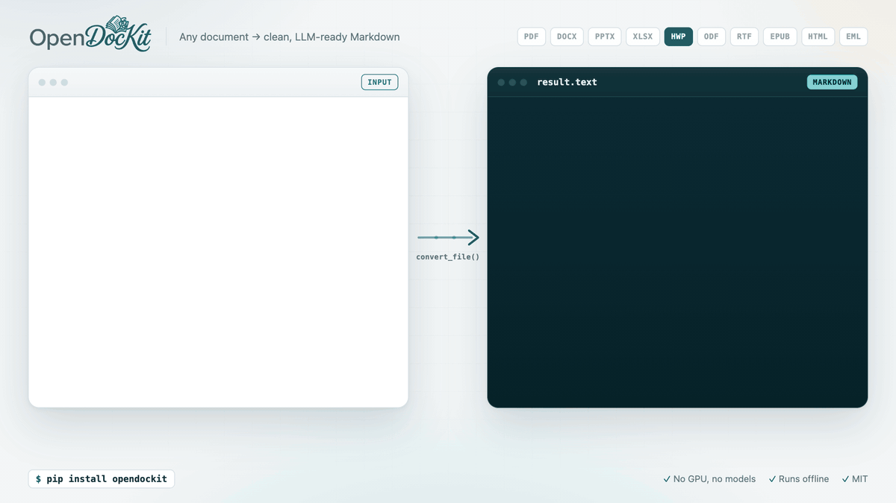
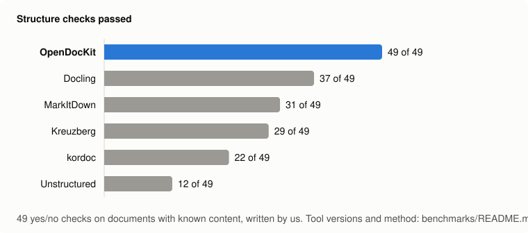
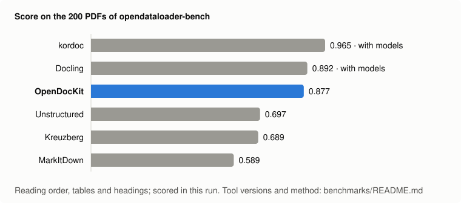
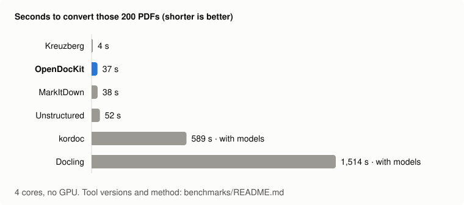

<h1 align="center">
  <picture>
    <source media="(prefers-color-scheme: dark)" srcset="https://raw.githubusercontent.com/hyeonsang010716/OpenDocKit/main/docs/assets/banner-dark.png">
    
  </picture>
</h1>

<p align="center">
  <b>어떤 문서든 LLM에 바로 넣을 수 있는 깔끔한 Markdown으로.</b><br>
  PDF · DOCX · PPTX · XLSX · HWP/HWPX · ODF · RTF · EPUB · HTML · 이메일 · 이미지 — 함수 하나, GPU 불필요, MIT 라이선스.
</p>

<p align="center">
  <a href="https://pypi.org/project/opendockit/"></a>
  <a href="https://pypi.org/project/opendockit/"></a>
  <a href="https://github.com/hyeonsang010716/OpenDocKit/actions/workflows/ci.yml"></a>
  <a href="https://github.com/hyeonsang010716/OpenDocKit/blob/main/LICENSE"></a>
  <a href="https://github.com/NousResearch/hermes-agent/blob/main/plugin-catalog/opendockit.yaml"></a>
  <a href="https://marketplace.dify.ai/plugin/hyeonsang010716/opendockit"></a>
</p>

<p align="center">
  <a href="https://github.com/hyeonsang010716/OpenDocKit/blob/main/README.md">English</a> ·
  <b>한국어</b> ·
  <a href="https://github.com/hyeonsang010716/OpenDocKit/blob/main/README.zh-CN.md">简体中文</a>
</p>

---

<p align="center">
  <picture>
    <source media="(prefers-color-scheme: dark)" srcset="https://raw.githubusercontent.com/hyeonsang010716/OpenDocKit/main/docs/assets/demo-dark.gif">
    
  </picture>
</p>

```python
from opendockit import convert_file

result = convert_file("quarterly-report.hwp")

result.text        # Markdown: 제목, 표, 목록, 각주, LaTeX 수식
result.sections    # 페이지 / 슬라이드 / 시트 단위 — 청킹과 출처 표기("3쪽")에 사용
result.warnings    # 건너뛰었거나 근사 처리한 내용을 평이한 문장으로
```

## 왜 OpenDocKit인가

대부분의 변환기는 잘 만들어진 문서만 잘 처리합니다. OpenDocKit은 사람들이 실제로 올리는 파일을 기준으로 만들었습니다.

- **텍스트만이 아니라 구조까지.** 병합된 표 셀, 다단 PDF, 테두리 없는 표, 중첩 목록, 각주, 발표자 노트를 살립니다.
  차트는 데이터 표로, SmartArt는 중첩 목록으로, Word · PowerPoint · 한글 수식은 LaTeX로, 링크와 굵게 · 기울임은
  Markdown으로 옮깁니다.
- **한국어 문서를 제대로 읽습니다.** 처음부터 직접 만든 HWP 5.x 파서, HWPX, CP949 감지, NFC 정규화, 그리고 한국
  사무 환경 특유의 서식 위주 표까지 다룹니다. 범용 변환기 대부분은 이런 파일을 아예 읽지 못합니다.
- **확장자가 아니라 내용으로 판별합니다.** `.xls`로 저장된 HTML 표, 제목 줄이 붙은 CSV, `.doc`라는 이름의 MHTML
  페이지도 실제 형식대로 읽고, 그 사실을 경고로 알려 줍니다.
- **신뢰할 수 없는 업로드에도 안전합니다.** 압축 폭탄, 터무니없는 병합 셀 개수, 재귀하는 PDF 객체, 수 기가바이트짜리
  이미지에 상한을 둡니다. `IsolatedConverter`는 파일마다 메모리와 시간 제한이 걸린 일회용 워커 프로세스에서
  변환합니다.
- **그림은 제자리에.** 그림, 차트, 스캔된 페이지를 추출하고 걸러 내며, 비전 모델을 연결하면 문서에서 그림이 있던
  바로 그 자리에 설명을 넣습니다.
- **엄격한 글자 수 예산.** `max_chars`는 변환을 끝낸 뒤 잘라 내는 것이 아니라 그 지점에서 작업을 *멈춥니다*.
  어차피 거절될 파일에 파싱 시간도 비전 모델 호출 비용도 쓰지 않습니다.
- **기본 설치는 허용적 라이선스만.** MIT 라이선스이며, `pip install opendockit`으로 설치되는 것은 모두
  MIT / BSD / Apache 계열입니다(PyMuPDF, pyhwp 없음). ML 모델도 GPU도 필요 없습니다. 카피레프트 코드는 선택
  설치인 `heic` 추가 기능에만 있습니다.

## 설치

```bash
pip install opendockit                # 변환만 — 네트워크를 전혀 사용하지 않음
pip install "opendockit[openai]"      # + 비전 모델로 이미지 설명
pip install "opendockit[heic]"        # + HEIC/HEIF 이미지 (GPL/LGPL 라이선스 코덱 라이브러리가 함께 설치됨)
pip install "opendockit[langchain]"   # + LangChain 로더
pip install "opendockit[llamaindex]"  # + LlamaIndex 리더
pip install "opendockit[mcp]"         # + 에이전트용 MCP 서버
pip install "opendockit[open-webui]"  # + Open WebUI용 문서 로더
```

Linux, macOS 또는 Windows에서 Python 3.12 이상이 필요합니다. Windows에서는 256 K자를 넘거나 아주 깊게 중첩된 잘못된 형식의
HTML 페이지·메일 본문이 구버전 파서로 읽히며 내용이 일부 누락될 수 있고, 그때는 경고가 함께 나옵니다
([이유](https://github.com/hyeonsang010716/OpenDocKit/blob/main/docs/limitations.md#platforms)).

선택 사항: 구형 `.doc`, `.ppt` 파일을 읽으려면 [LibreOffice](https://www.libreoffice.org/)를 설치하세요
(`brew install --cask libreoffice`, `apt install libreoffice`). 그 밖의 형식은 모두 OpenDocKit이 직접 읽습니다.

## 빠른 시작

### 변환

```python
from opendockit import convert, convert_file

result = convert_file("report.pdf")              # 경로에서
result = convert(data, "report.pdf")             # 바이트에서 (파일명은 힌트일 뿐)

print(result.text)
print(result.char_count, result.exceeded)        # 출력 크기와, 제한에 걸려 멈췄는지 여부
```

`convert`는 동기 방식이고, 오프라인으로 동작하며, 같은 입력에 항상 같은 결과를 냅니다(유일한 예외: `.doc`와
`.ppt`는 로컬 LibreOffice 프로세스를 실행합니다). 그림은 `result.images`에 모이고, 본문에는 그림이 있던 자리마다
`[Image]` 자리표시자가 남습니다.

### 비전 모델로 이미지 설명하기

```python
from opendockit import OpenAIImageDescriber, aconvert

result = await aconvert(data, "report.pdf", describer=OpenAIImageDescriber())   # OPENAI_API_KEY를 읽음
```

차트는 데이터 표가 되고, 다이어그램은 목록이 되고, 스캔된 페이지는 글자로 옮겨지며, 장식용 이미지는 빠집니다.
`OpenAIImageDescriber(model)`에는 어떤 LangChain 채팅 모델이든 넣을 수 있고, `async describe(image) -> str`
메서드만 있으면 무엇이든 설명기로 쓸 수 있습니다. [docs/images.md](https://github.com/hyeonsang010716/OpenDocKit/blob/main/docs/images.md)를 참고하세요.

### 서버에서 사용하기

```python
from opendockit import ConversionError, IsolatedConverter

async with IsolatedConverter(workers=2) as converter:      # 기본값: 파일당 2 GB, 2분
    try:
        result = await converter.convert(data, filename)
    except ConversionError as exc:
        print(exc.code, exc)                               # 고정된 코드 + 사용자에게 그대로 보여 줘도 되는 메시지
```

문제 있는 파일 하나는 워커 하나만 끝낼 뿐, 서버와 다음 업로드는 계속 동작합니다. 스크립트에서는 이 코드를
`if __name__ == "__main__":` 아래에서 실행하세요. 워커가 메인 모듈을 다시 불러오기 때문입니다.
[docs/server.md](https://github.com/hyeonsang010716/OpenDocKit/blob/main/docs/server.md)를 참고하세요.

### 명령줄

```bash
opendockit report.pdf                 # Markdown은 표준 출력, 경고는 표준 오류로
opendockit report.pdf --json          # 섹션, 메타데이터, 경고, 이미지
opendockit report.pdf --count         # 글자 수만
opendockit scan.pdf --describe        # 비전 모델로 이미지 설명 (OPENAI_API_KEY 사용)
```

### LangChain, LlamaIndex, MCP

```python
from opendockit.integrations.langchain import OpenDocKitLoader
from opendockit.integrations.llama_index import OpenDocKitReader

docs = OpenDocKitLoader("report.pdf", mode="sections").load()       # 페이지 / 슬라이드 / 시트마다 Document 하나
docs = OpenDocKitReader(mode="sections").load_data("report.pdf")
```

```bash
opendockit-mcp --root ~/Documents     # MCP 서버: Claude, Cursor 등의 에이전트가 내 문서를 Markdown으로 읽음
```

미리 설치하지 않고 클라이언트가 서버를 직접 실행하게 하려면, 클라이언트의 MCP 설정에 다음을 추가합니다.

```json
{
  "mcpServers": {
    "opendockit": {
      "command": "uvx",
      "args": ["opendockit-mcp", "--root", "/path/to/documents"]
    }
  }
}
```

`mode="sections"`를 주면 페이지, 슬라이드, 시트가 각각 하나의 Document가 되고, 그 번호가 메타데이터에 들어 있어 출처 표기에 쓸 수 있습니다.
[docs/integrations.md](https://github.com/hyeonsang010716/OpenDocKit/blob/main/docs/integrations.md)를 참고하세요.

[](https://glama.ai/mcp/servers/hyeonsang010716/OpenDocKit)

### Hermes Agent

OpenDocKit은 [Hermes Agent 플러그인 카탈로그](https://github.com/NousResearch/hermes-agent/tree/main/plugin-catalog)에 등록되어 있습니다. 이 카탈로그의 플러그인은 모두 Hermes
메인테이너가 검토하고 커밋 하나에 고정합니다.

```bash
hermes plugins install opendockit
hermes plugins enable opendockit
```

새 세션에서 내 컴퓨터에 있는 파일에 대해 물어보면 됩니다. 긴 문서는 페이지·슬라이드·시트 단위로 읽고, 문서를 어디에도
보내지 않으며 API 키도 필요 없습니다. 플러그인이 실행하는 것과 읽을 수 있는 폴더를 제한하는 방법은
[hermes-plugin/README.md](https://github.com/hyeonsang010716/OpenDocKit/blob/main/hermes-plugin/README.md)에 있습니다.

### Claude Code

이 저장소가 플러그인의 마켓플레이스입니다. 다음 한 줄로 설치합니다.

```text
/plugin install opendockit --marketplace hyeonsang010716/OpenDocKit
```

그다음 내 컴퓨터의 문서에 대해 Claude에게 물어보세요. Read 도구가 열지 못하는 Word, PowerPoint, Excel, HWP/HWPX 파일을 읽고,
긴 PDF는 페이지 단위로 읽습니다. 플러그인이 실행하는 것과 읽을 수 있는 폴더를 제한하는 방법은
[claude-plugin/README.md](https://github.com/hyeonsang010716/OpenDocKit/blob/main/claude-plugin/README.md)에 있습니다.

### Dify

OpenDocKit은 [Dify Marketplace](https://marketplace.dify.ai/plugin/hyeonsang010716/opendockit)에 등록되어 있습니다. Dify 메인테이너의 검토를 거쳤습니다. 내 Dify에서 **Plugins**를
열고 Marketplace에서 OpenDocKit을 찾아 설치하세요. 그다음 Workflow나 Chatflow에서:

1. **Start** 노드에 **File** 변수를 추가합니다. HWP와 HWPX는 **Other file types**를 고르고 `.hwp`와 `.hwpx`를
   추가합니다.
2. **OpenDocKit → Convert to Markdown** 도구를 추가하고 파일을 넘깁니다.
3. LLM 노드에서 `text`를 쓰거나, 페이지·슬라이드·시트마다 하나씩 나오는 `documents`를 씁니다.

Dify는 HWP와 HWPX를 직접 읽지 못합니다. 파일은 내 Dify 안에서, 메모리와 시간 제한이 걸린 작업 프로세스에서 변환되며 API
키가 필요 없고 다른 곳으로 아무것도 보내지 않습니다. 출력과 한계는
[dify-plugin/README.md](https://github.com/hyeonsang010716/OpenDocKit/blob/main/dify-plugin/README.md)에 있습니다.

### Open WebUI

`opendockit-open-webui`는 Open WebUI의 **External** 콘텐츠 추출 엔진에 붙이는 문서 로더입니다. Open WebUI가 업로드된
파일을 모두 이 로더로 보내고, 페이지·슬라이드·시트마다 문서 하나씩을 색인합니다. PDF에서 온 인용은 해당 페이지를 표시하고
그 페이지를 엽니다. Open WebUI는 HWP와 HWPX를 직접 읽지 못합니다.

```bash
pip install "opendockit[open-webui]"
export OPENDOCKIT_OPEN_WEBUI_API_KEY=$(openssl rand -hex 32)
opendockit-open-webui --host 0.0.0.0     # then in Open WebUI: Documents → External, this URL and the same key
```

**Admin Settings → Documents**에서 **Content Extraction Engine**을 **External**로 바꾸고 로더의 URL과 같은 API 키를
넣으세요. 파일은 메모리와 시간 제한이 걸린 작업 프로세스에서 오프라인으로 변환됩니다. Docker Compose 설정, 제한과 오류는
[docs/integrations.md](https://github.com/hyeonsang010716/OpenDocKit/blob/main/docs/integrations.md#open-webui-document-loader)에 있습니다.

## 지원 형식

| 형식 | 섹션 단위 | 주요 기능 |
| --- | --- | --- |
| PDF | 페이지 | 다단 읽기 순서, 선이 있는 표와 테두리 없는 표, 양식 필드 값, 글자 크기와 굵기로 추정한 제목, 반복되는 머리글 · 바닥글 제거, 근거가 확실한 페이지의 각주 연결, 스캔 페이지는 비전 모델로 |
| DOCX | 문서 | 제목 스타일, 목록 번호, 병합 셀, 차트 → 표, SmartArt, 각주 · 미주, 수식 → LaTeX, 메모 |
| PPTX | 슬라이드 | 화면에 보이는 순서, 글머리 기호 수준, 표, 차트 → 표, SmartArt, 수식, 발표자 노트 |
| XLSX · XLS · Excel 2003 XML · CSV | 시트 | 한 시트 안의 여러 표, 병합 셀, 숫자 · 날짜 표시 형식, 차트, 셀 메모 |
| HWP · HWPX | 문서 | 개요 제목, 문단 번호, 병합 셀, 캡션, 각주, 수식 → LaTeX |
| ODT · ODS · ODP | 문서 / 시트 / 슬라이드 | 패키지를 직접 읽음: 제목, 목록, 병합 셀, 차트, 수식 → LaTeX, 발표자 노트 |
| RTF | 문서 | 내장 파서: 구형 코드 페이지(CP949), 병합 셀이 있는 표, 목록, 각주, 그림 |
| EPUB | 문서 | 읽는 순서대로의 장, 책에 포함된 그림, 메타데이터 |
| DOC · PPT | 문서 / 슬라이드 | LibreOffice가 설치되어 있으면 이를 통해 변환한 뒤 DOCX / PPTX처럼 읽음 |
| HTML · MHTML | 문서 | rowspan/colspan이 있는 표, 레이아웃용 표 풀기, MathML → LaTeX, 숨겨진 요소 제거 |
| 이메일 (`.eml`, mbox) | 문서 | 헤더, HTML 또는 일반 텍스트 본문, 전달된 메시지, 일정 초대 |
| TXT · Markdown | 문서 | 인코딩 감지 (UTF-8, CP949, UTF-16, Windows-1252) |
| 이미지 | 문서 / 페이지 | JPEG, PNG, WebP, GIF, BMP, TIFF, AVIF, 그리고 `heic` 추가 기능으로 HEIC — 비전 모델이 설명 |

구형 `.doc`와 `.ppt`는 LibreOffice가 설치되어 있어야 하고, 나머지는 모두 OpenDocKit이 직접 읽습니다. 형식별로
무엇을 복원하는지는 [docs/formats.md](https://github.com/hyeonsang010716/OpenDocKit/blob/main/docs/formats.md)에,
무엇을 못 하는지는 [docs/limitations.md](https://github.com/hyeonsang010716/OpenDocKit/blob/main/docs/limitations.md)에
숨김없이 적어 두었습니다.

## 다른 도구와의 비교

<p align="center">
  
</p>

OpenDocKit, MarkItDown, Kreuzberg, Unstructured, Docling, kordoc을 GPU 없는 4코어 표준 GitHub 러너에서 같은 파일로
돌렸습니다. 측정 방법과 원본 결과, 직접 다시 돌리는 법은 [전체 보고서](https://github.com/hyeonsang010716/OpenDocKit/blob/main/benchmarks/README.md)에 있습니다.

|  | OpenDocKit | MarkItDown | Kreuzberg | Unstructured | Docling | kordoc |
| --- | :---: | :---: | :---: | :---: | :---: | :---: |
| 읽은 형식 (31개 중) | **26** | 19 | 22 | 24 | 22 | 11 |
| HWP · HWPX | ✅ | ❌ | ❌ | ❌ | ❌ | ✅ |
| 통과한 구조 검사 (49개 중, 저희가 만든 검사) | **49** | 31 | 29 | 12 | 37 | 22 |
| PDF 벤치마크 점수 (200개 파일, 외부 벤치마크) | 0.877 | 0.589 | 0.689 | 0.697 | 0.892 | **0.965** |
| 그 PDF 200개에 걸린 시간 (초) | 37 | 38 | **4** | 52 | 1,514 | 589 |
| 그때의 최대 메모리 (MB) | 222 | 310 | **82** | 2,127 | 3,023 | 1,309 |
| 설치 크기 (MB) | **103** | 337 | 5,792 | 6,746 | 5,987 | 670 |

- **모델 없이 가장 넓게 읽습니다.** 테스트한 31개 형식 중 26개를 CPU만으로 읽어 여섯 도구 가운데 가장 많고,
  "병합된 셀이 여전히 제 행에 붙어 있는가" 같은 구조 검사 49개를 모두 통과합니다. 다만 이 검사는 저희가 만든
  것이라, 그 점을 어떻게 받아들여야 하는지 보고서에 적어 두었습니다.
- **PDF는 모델을 쓰는 도구에 가깝고, 시간은 훨씬 덜 듭니다.** 저희가 만들지 않은 벤치마크인 opendataloader-bench의
  PDF 200개에서 OpenDocKit은 0.877점입니다. kordoc(0.965)과 Docling(0.892)이 더 높지만 둘은 모델을 돌려서 얻은
  점수이고, 200개를 처리하는 데 각각 589초와 1,514초가 걸립니다. OpenDocKit은 37초입니다.
- **HWP와 HWPX.** 이 두 형식을 읽는 도구는 OpenDocKit과 kordoc뿐입니다. PDF 점수와 로컬 스캔 인식은 kordoc이
  앞서고, OpenDocKit은 나머지 형식까지 같은 함수 하나로, Python에서 읽습니다.
- **모르는 사람이 올린 파일을 받는 서버를 위해 만들었습니다.** 퍼저가 찾아낸 파일과 공격용 파일 113개에서 한 번도
  죽거나 멈추지 않았고, 가장 크게 쓴 메모리가 97 MB였습니다. 그중 한 파일은 다른 도구 2개를 6 GB 너머로
  밀어 올렸습니다.
- **부족한 점.** OCR이 없습니다. 스캔 문서와 이미지는 비전 모델이 있어야 읽고, Docling · Unstructured · kordoc은
  로컬에서 읽습니다. PDF에서 가장 약한 항목은 표입니다(0.776, kordoc은 0.981). 속도는 Kreuzberg가 전반적으로 훨씬
  빠르고, 구형 `.doc` / `.ppt`는 LibreOffice를 거칩니다.

<p align="center">
  
  
</p>

## 예제

[`examples/`](https://github.com/hyeonsang010716/OpenDocKit/tree/main/examples/)에는 형식마다 샘플 문서 하나와,
OpenDocKit이 그 문서에서 만들어 낸 Markdown이 비전 모델을 쓴 경우와 쓰지 않은 경우로 나뉘어 들어 있습니다.
설치하기 전에 출력을 직접 보고 판단할 수 있습니다.

## 문서

아래 문서는 영어로 작성되어 있습니다.

| | |
| --- | --- |
| [형식](https://github.com/hyeonsang010716/OpenDocKit/blob/main/docs/formats.md) | 형식별로 무엇을 추출하고 어떻게 표현하는지 |
| [옵션](https://github.com/hyeonsang010716/OpenDocKit/blob/main/docs/options.md) | `ConvertOptions`, 예외, 오류 코드 |
| [이미지](https://github.com/hyeonsang010716/OpenDocKit/blob/main/docs/images.md) | 추출, 필터링, 비전 모델, 직접 만드는 설명기 |
| [서버에서 실행하기](https://github.com/hyeonsang010716/OpenDocKit/blob/main/docs/server.md) | `IsolatedConverter`, 자원 제한, 글자 수 예산 |
| [연동](https://github.com/hyeonsang010716/OpenDocKit/blob/main/docs/integrations.md) | LangChain, LlamaIndex, MCP 서버, Hermes Agent, Claude Code, Dify, Open WebUI |
| [연동 가이드](https://github.com/hyeonsang010716/OpenDocKit/blob/main/docs/integration-guide.md) | 업로드 화면에서 사용자에게 알려야 할 것 |
| [설계](https://github.com/hyeonsang010716/OpenDocKit/blob/main/docs/design.md) | 왜 이렇게 만들었고 어떻게 검증했는지 |
| [한계](https://github.com/hyeonsang010716/OpenDocKit/blob/main/docs/limitations.md) | 알려진 한계를 있는 그대로 |
| [결정 기록](https://github.com/hyeonsang010716/OpenDocKit/tree/main/docs/decisions/) | 의도적으로 내린 모든 절충과, 그것을 고정하는 테스트 |

## 기여

기여를 환영합니다. 문제를 재현하는 최소한의 문서가 첨부된 버그 리포트가 특히 큰 도움이 됩니다.
[CONTRIBUTING.md](https://github.com/hyeonsang010716/OpenDocKit/blob/main/CONTRIBUTING.md)부터 읽어 주세요.

```bash
git clone https://github.com/hyeonsang010716/OpenDocKit.git && cd OpenDocKit
uv sync
uv run pytest -n auto -m "not timing"   # 테스트 대부분을 병렬로
uv run pytest -m timing                  # 시간을 재는 테스트를 하나씩
uv run ruff check
```

## 라이선스

[MIT](https://github.com/hyeonsang010716/OpenDocKit/blob/main/LICENSE)

---

이 문서는 [README.md](https://github.com/hyeonsang010716/OpenDocKit/blob/main/README.md)의 한국어 번역입니다.
내용이 서로 다르면 영어판이 기준입니다.
