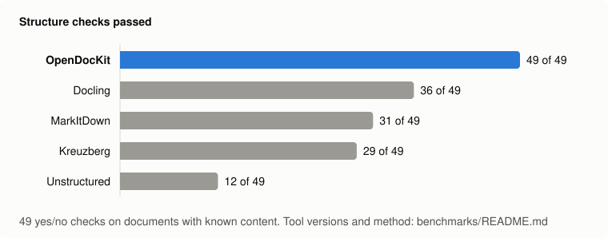

<h1 align="center">OpenDocKit</h1>

<p align="center">
  <b>어떤 문서든 LLM에 바로 넣을 수 있는 깔끔한 Markdown으로.</b><br>
  PDF · DOCX · PPTX · XLSX · HWP/HWPX · ODF · RTF · EPUB · HTML · 이메일 · 이미지 — 함수 하나, GPU 불필요, MIT 라이선스.
</p>

<p align="center">
  <a href="https://pypi.org/project/opendockit/"></a>
  <a href="https://pypi.org/project/opendockit/"></a>
  <a href="https://github.com/hyeonsang010716/OpenDocKit/actions/workflows/ci.yml"></a>
  <a href="https://github.com/hyeonsang010716/OpenDocKit/blob/main/LICENSE"></a>
</p>

<p align="center">
  <a href="https://github.com/hyeonsang010716/OpenDocKit/blob/main/README.md">English</a> ·
  <b>한국어</b> ·
  <a href="https://github.com/hyeonsang010716/OpenDocKit/blob/main/README.zh-CN.md">简体中文</a>
</p>

---

```python
from opendockit import convert_file

result = convert_file("quarterly-report.hwp")

result.text        # Markdown: 제목, 표, 목록, 각주, LaTeX 수식
result.sections    # 페이지 / 슬라이드 / 시트 단위 — 청킹과 출처 표기("3쪽")에 사용
result.warnings    # 건너뛰었거나 근사 처리한 내용을 평이한 문장으로
```

## 왜 OpenDocKit인가

대부분의 변환기는 잘 만들어진 문서만 잘 처리합니다. OpenDocKit은 사람들이 실제로 올리는 파일을 기준으로 만들었습니다.

- **텍스트만이 아니라 구조까지.** 병합된 표 셀, 다단 PDF, 테두리 없는 표, 중첩 목록, 각주, 발표자 노트를 살립니다.
  차트는 데이터 표로, SmartArt는 중첩 목록으로, Word · PowerPoint · 한글 수식은 LaTeX로, 링크와 굵게 · 기울임은
  Markdown으로 옮깁니다.
- **한국어 문서를 제대로 읽습니다.** 처음부터 직접 만든 HWP 5.x 파서, HWPX, CP949 감지, NFC 정규화, 그리고 한국
  사무 환경 특유의 서식 위주 표까지 다룹니다. 범용 변환기 대부분은 이런 파일을 아예 읽지 못합니다.
- **확장자가 아니라 내용으로 판별합니다.** `.xls`로 저장된 HTML 표, 제목 줄이 붙은 CSV, `.doc`라는 이름의 MHTML
  페이지도 실제 형식대로 읽고, 그 사실을 경고로 알려 줍니다.
- **신뢰할 수 없는 업로드에도 안전합니다.** 압축 폭탄, 터무니없는 병합 셀 개수, 재귀하는 PDF 객체, 수 기가바이트짜리
  이미지에 상한을 둡니다. `IsolatedConverter`는 파일마다 메모리와 시간 제한이 걸린 일회용 워커 프로세스에서
  변환합니다.
- **그림은 제자리에.** 그림, 차트, 스캔된 페이지를 추출하고 걸러 내며, 비전 모델을 연결하면 문서에서 그림이 있던
  바로 그 자리에 설명을 넣습니다.
- **엄격한 글자 수 예산.** `max_chars`는 변환을 끝낸 뒤 잘라 내는 것이 아니라 그 지점에서 작업을 *멈춥니다*.
  어차피 거절될 파일에 파싱 시간도 비전 모델 호출 비용도 쓰지 않습니다.
- **기본 설치는 허용적 라이선스만.** MIT 라이선스이며, `pip install opendockit`으로 설치되는 것은 모두
  MIT / BSD / Apache 계열입니다(PyMuPDF, pyhwp 없음). ML 모델도 GPU도 필요 없습니다. 카피레프트 코드는 선택
  설치인 `heic` 추가 기능에만 있습니다.

## 설치

```bash
pip install opendockit                # 변환만 — 네트워크를 전혀 사용하지 않음
pip install "opendockit[openai]"      # + 비전 모델로 이미지 설명
pip install "opendockit[heic]"        # + HEIC/HEIF 이미지 (GPL/LGPL 라이선스 코덱 라이브러리가 함께 설치됨)
pip install "opendockit[langchain]"   # + LangChain 로더
pip install "opendockit[llamaindex]"  # + LlamaIndex 리더
pip install "opendockit[mcp]"         # + 에이전트용 MCP 서버
```

Linux 또는 macOS에서 Python 3.12 이상이 필요합니다. Windows에서는 HTML, 이메일, EPUB를 아직 지원하지 않습니다
([이유](https://github.com/hyeonsang010716/OpenDocKit/blob/main/docs/limitations.md#platforms)).

선택 사항: 구형 `.doc`, `.ppt` 파일을 읽으려면 [LibreOffice](https://www.libreoffice.org/)를 설치하세요
(`brew install --cask libreoffice`, `apt install libreoffice`). 그 밖의 형식은 모두 OpenDocKit이 직접 읽습니다.

## 빠른 시작

### 변환

```python
from opendockit import convert, convert_file

result = convert_file("report.pdf")              # 경로에서
result = convert(data, "report.pdf")             # 바이트에서 (파일명은 힌트일 뿐)

print(result.text)
print(result.char_count, result.exceeded)        # 출력 크기와, 제한에 걸려 멈췄는지 여부
```

`convert`는 동기 방식이고, 오프라인으로 동작하며, 같은 입력에 항상 같은 결과를 냅니다(유일한 예외: `.doc`와
`.ppt`는 로컬 LibreOffice 프로세스를 실행합니다). 그림은 `result.images`에 모이고, 본문에는 그림이 있던 자리마다
`[Image]` 자리표시자가 남습니다.

### 비전 모델로 이미지 설명하기

```python
from opendockit import OpenAIImageDescriber, aconvert

result = await aconvert(data, "report.pdf", describer=OpenAIImageDescriber())   # OPENAI_API_KEY를 읽음
```

차트는 데이터 표가 되고, 다이어그램은 목록이 되고, 스캔된 페이지는 글자로 옮겨지며, 장식용 이미지는 빠집니다.
`OpenAIImageDescriber(model)`에는 어떤 LangChain 채팅 모델이든 넣을 수 있고, `async describe(image) -> str`
메서드만 있으면 무엇이든 설명기로 쓸 수 있습니다. [docs/images.md](https://github.com/hyeonsang010716/OpenDocKit/blob/main/docs/images.md)를 참고하세요.

### 서버에서 사용하기

```python
from opendockit import ConversionError, IsolatedConverter

async with IsolatedConverter(workers=2) as converter:      # 기본값: 파일당 2 GB, 2분
    try:
        result = await converter.convert(data, filename)
    except ConversionError as exc:
        print(exc.code, exc)                               # 고정된 코드 + 사용자에게 그대로 보여 줘도 되는 메시지
```

문제 있는 파일 하나는 워커 하나만 끝낼 뿐, 서버와 다음 업로드는 계속 동작합니다. 스크립트에서는 이 코드를
`if __name__ == "__main__":` 아래에서 실행하세요. 워커가 메인 모듈을 다시 불러오기 때문입니다.
[docs/server.md](https://github.com/hyeonsang010716/OpenDocKit/blob/main/docs/server.md)를 참고하세요.

### 명령줄

```bash
opendockit report.pdf                 # Markdown은 표준 출력, 경고는 표준 오류로
opendockit report.pdf --json          # 섹션, 메타데이터, 경고, 이미지
opendockit report.pdf --count         # 글자 수만
opendockit scan.pdf --describe        # 비전 모델로 이미지 설명 (OPENAI_API_KEY 사용)
```

### LangChain, LlamaIndex, MCP

```python
from opendockit.integrations.langchain import OpenDocKitLoader
from opendockit.integrations.llama_index import OpenDocKitReader

docs = OpenDocKitLoader("report.pdf", mode="sections").load()       # 페이지 / 슬라이드 / 시트마다 Document 하나
docs = OpenDocKitReader(mode="sections").load_data("report.pdf")
```

```bash
opendockit-mcp --root ~/Documents     # MCP 서버: Claude, Cursor 등의 에이전트가 내 문서를 Markdown으로 읽음
```

`mode="sections"`를 주면 페이지, 슬라이드, 시트가 각각 하나의 Document가 되고, 그 번호가 메타데이터에 들어 있어 출처 표기에 쓸 수 있습니다.
[docs/integrations.md](https://github.com/hyeonsang010716/OpenDocKit/blob/main/docs/integrations.md)를 참고하세요.

## 지원 형식

| 형식 | 섹션 단위 | 주요 기능 |
| --- | --- | --- |
| PDF | 페이지 | 다단 읽기 순서, 선이 있는 표와 테두리 없는 표, 양식 필드 값, 글자 크기로 추정한 제목, 반복되는 머리글 · 바닥글 제거, 스캔 페이지는 비전 모델로 |
| DOCX | 문서 | 제목 스타일, 목록 번호, 병합 셀, 차트 → 표, SmartArt, 각주 · 미주, 수식 → LaTeX, 메모 |
| PPTX | 슬라이드 | 화면에 보이는 순서, 글머리 기호 수준, 표, 차트 → 표, SmartArt, 수식, 발표자 노트 |
| XLSX · XLS · Excel 2003 XML · CSV | 시트 | 한 시트 안의 여러 표, 병합 셀, 숫자 · 날짜 표시 형식, 차트, 셀 메모 |
| HWP · HWPX | 문서 | 개요 제목, 문단 번호, 병합 셀, 캡션, 각주, 수식 → LaTeX |
| ODT · ODS · ODP | 문서 / 시트 / 슬라이드 | 패키지를 직접 읽음: 제목, 목록, 병합 셀, 차트, 수식 → LaTeX, 발표자 노트 |
| RTF | 문서 | 내장 파서: 구형 코드 페이지(CP949), 병합 셀이 있는 표, 목록, 각주, 그림 |
| EPUB | 문서 | 읽는 순서대로의 장, 책에 포함된 그림, 메타데이터 |
| DOC · PPT | 문서 / 슬라이드 | LibreOffice가 설치되어 있으면 이를 통해 변환한 뒤 DOCX / PPTX처럼 읽음 |
| HTML · MHTML | 문서 | rowspan/colspan이 있는 표, 레이아웃용 표 풀기, MathML → LaTeX, 숨겨진 요소 제거 |
| 이메일 (`.eml`, mbox) | 문서 | 헤더, HTML 또는 일반 텍스트 본문, 전달된 메시지, 일정 초대 |
| TXT · Markdown | 문서 | 인코딩 감지 (UTF-8, CP949, UTF-16, Windows-1252) |
| 이미지 | 문서 / 페이지 | JPEG, PNG, WebP, GIF, BMP, TIFF, AVIF, 그리고 `heic` 추가 기능으로 HEIC — 비전 모델이 설명 |

구형 `.doc`와 `.ppt`는 LibreOffice가 설치되어 있어야 하고, 나머지는 모두 OpenDocKit이 직접 읽습니다. 형식별로
무엇을 복원하는지는 [docs/formats.md](https://github.com/hyeonsang010716/OpenDocKit/blob/main/docs/formats.md)에,
무엇을 못 하는지는 [docs/limitations.md](https://github.com/hyeonsang010716/OpenDocKit/blob/main/docs/limitations.md)에
숨김없이 적어 두었습니다.

## 다른 도구와의 비교

<p align="center">
  
</p>

OpenDocKit, MarkItDown, Kreuzberg, Unstructured, Docling을 표준 GitHub 러너에서 같은 파일로 실행했습니다
([방법, 원본 결과, 직접 다시 돌리는 법](https://github.com/hyeonsang010716/OpenDocKit/blob/main/benchmarks/README.md)).

- **구조** — OpenDocKit이 가장 많이 보존합니다. "병합된 셀이 여전히 제 행에 붙어 있는가" 같은 검사 49개 중 49개를
  통과했고, 다음 도구는 36개입니다. 다만 이 검사는 저희가 만든 것이고 0.2.0은 그 항목을 알고 개발했습니다. 그것이
  무엇을 뜻하는지는 보고서에 적어 두었습니다.
- **형식** — 테스트한 31개 형식 중 26개를 모델이나 외부 서비스 없이 읽습니다. 다섯 도구 중 가장 많고, HWP와
  HWPX를 읽는 도구는 OpenDocKit뿐입니다.
- **가장 빠르지는 않고, OCR이 없습니다** — 스캔 문서와 이미지는 비전 모델을 통해서만 읽습니다. Docling과
  Unstructured는 오프라인으로 읽습니다. Kreuzberg는 약 30배 빠르고, 구형 `.doc` / `.ppt`는 LibreOffice를 거치기
  때문에 파일당 1초 정도 걸립니다.

## 예제

[`examples/`](https://github.com/hyeonsang010716/OpenDocKit/tree/main/examples/)에는 형식마다 샘플 문서 하나와,
OpenDocKit이 그 문서에서 만들어 낸 Markdown이 비전 모델을 쓴 경우와 쓰지 않은 경우로 나뉘어 들어 있습니다.
설치하기 전에 출력을 직접 보고 판단할 수 있습니다.

## 문서

아래 문서는 영어로 작성되어 있습니다.

| | |
| --- | --- |
| [형식](https://github.com/hyeonsang010716/OpenDocKit/blob/main/docs/formats.md) | 형식별로 무엇을 추출하고 어떻게 표현하는지 |
| [옵션](https://github.com/hyeonsang010716/OpenDocKit/blob/main/docs/options.md) | `ConvertOptions`, 예외, 오류 코드 |
| [이미지](https://github.com/hyeonsang010716/OpenDocKit/blob/main/docs/images.md) | 추출, 필터링, 비전 모델, 직접 만드는 설명기 |
| [서버에서 실행하기](https://github.com/hyeonsang010716/OpenDocKit/blob/main/docs/server.md) | `IsolatedConverter`, 자원 제한, 글자 수 예산 |
| [연동](https://github.com/hyeonsang010716/OpenDocKit/blob/main/docs/integrations.md) | LangChain, LlamaIndex, MCP 서버 |
| [연동 가이드](https://github.com/hyeonsang010716/OpenDocKit/blob/main/docs/integration-guide.md) | 업로드 화면에서 사용자에게 알려야 할 것 |
| [설계](https://github.com/hyeonsang010716/OpenDocKit/blob/main/docs/design.md) | 왜 이렇게 만들었고 어떻게 검증했는지 |
| [한계](https://github.com/hyeonsang010716/OpenDocKit/blob/main/docs/limitations.md) | 알려진 한계를 있는 그대로 |
| [결정 기록](https://github.com/hyeonsang010716/OpenDocKit/tree/main/docs/decisions/) | 의도적으로 내린 모든 절충과, 그것을 고정하는 테스트 |

## 기여

기여를 환영합니다. 문제를 재현하는 최소한의 문서가 첨부된 버그 리포트가 특히 큰 도움이 됩니다.
[CONTRIBUTING.md](https://github.com/hyeonsang010716/OpenDocKit/blob/main/CONTRIBUTING.md)부터 읽어 주세요.

```bash
git clone https://github.com/hyeonsang010716/OpenDocKit.git && cd OpenDocKit
uv sync
uv run pytest -n auto -m "not timing"   # 테스트 대부분을 병렬로
uv run pytest -m timing                  # 시간을 재는 테스트를 하나씩
uv run ruff check
```

## 라이선스

[MIT](https://github.com/hyeonsang010716/OpenDocKit/blob/main/LICENSE)

---

이 문서는 [README.md](https://github.com/hyeonsang010716/OpenDocKit/blob/main/README.md)의 한국어 번역입니다.
내용이 서로 다르면 영어판이 기준입니다.
