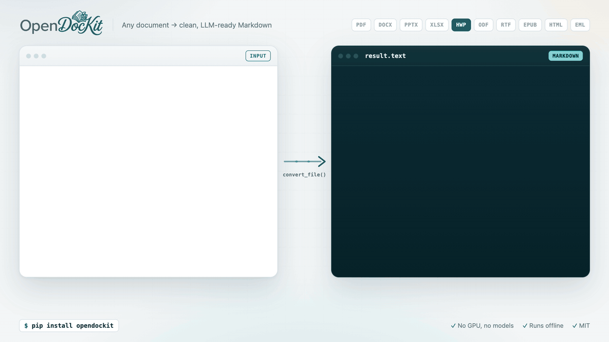
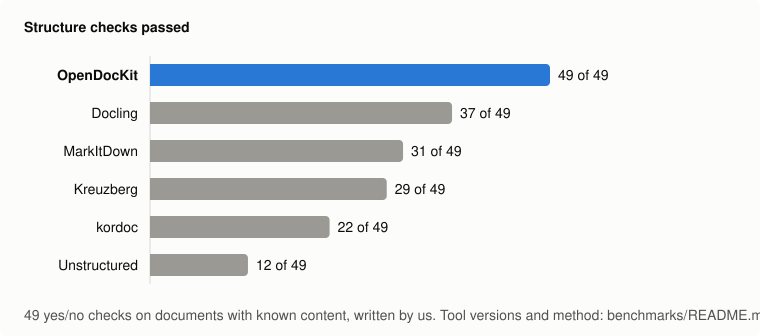
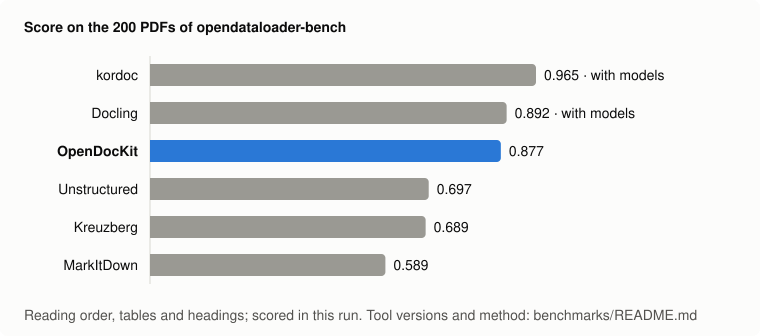
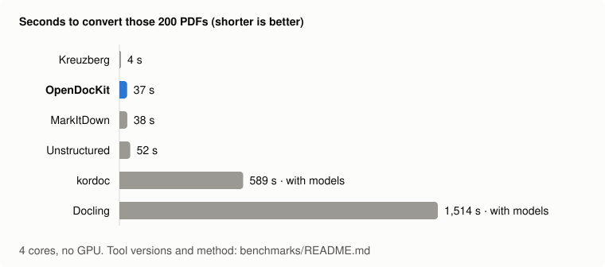

<h1 align="center">
  <picture>
    <source media="(prefers-color-scheme: dark)" srcset="https://raw.githubusercontent.com/hyeonsang010716/OpenDocKit/main/docs/assets/banner-dark.png">
    
  </picture>
</h1>

<p align="center">
  <b>Turn any document into clean, LLM-ready Markdown.</b><br>
  PDF · DOCX · PPTX · XLSX · HWP/HWPX · ODF · RTF · EPUB · HTML · email · images — one function, no GPU, MIT licensed.
</p>

<p align="center">
  <a href="https://pypi.org/project/opendockit/"></a>
  <a href="https://pypi.org/project/opendockit/"></a>
  <a href="https://github.com/hyeonsang010716/OpenDocKit/actions/workflows/ci.yml"></a>
  <a href="https://github.com/hyeonsang010716/OpenDocKit/blob/main/LICENSE"></a>
  <a href="https://github.com/NousResearch/hermes-agent/blob/main/plugin-catalog/opendockit.yaml"></a>
  <a href="https://marketplace.dify.ai/plugin/hyeonsang010716/opendockit"></a>
</p>

<p align="center">
  <b>English</b> ·
  <a href="https://github.com/hyeonsang010716/OpenDocKit/blob/main/README.ko.md">한국어</a> ·
  <a href="https://github.com/hyeonsang010716/OpenDocKit/blob/main/README.zh-CN.md">简体中文</a>
</p>

---

<p align="center">
  <picture>
    <source media="(prefers-color-scheme: dark)" srcset="https://raw.githubusercontent.com/hyeonsang010716/OpenDocKit/main/docs/assets/demo-dark.gif">
    
  </picture>
</p>

```python
from opendockit import convert_file

result = convert_file("quarterly-report.hwp")

result.text        # Markdown: headings, tables, lists, footnotes, LaTeX equations
result.sections    # per page / slide / sheet — for chunking and citations ("page 3")
result.warnings    # what was skipped or approximated, in plain sentences
```

## Why OpenDocKit

Most converters handle the happy path. OpenDocKit is built for the files people actually upload.

- **Structure, not just text.** Merged table cells, multi-column PDFs, borderless tables, nested lists, footnotes,
  speaker notes, native charts as data tables, SmartArt as nested lists, Word / PowerPoint / Hancom equations as LaTeX,
  links and bold / italic as Markdown.
- **First-class Korean documents.** A from-scratch HWP 5.x parser, HWPX, CP949 detection, NFC normalization, and the
  form-heavy tables Korean offices produce. Most general-purpose converters cannot read these at all.
- **Detects by content, not extension.** An HTML table saved as `.xls`, a CSV with a title block, an MHTML page named
  `.doc` — each is read as what it really is, and a warning tells you.
- **Safe on untrusted uploads.** Zip bombs, runaway merged-cell counts, recursive PDF objects and multi-gigabyte images
  are bounded. `IsolatedConverter` runs every file in a disposable worker process with memory and time limits.
- **Images in place.** Pictures, charts and scanned pages are extracted, filtered, and — if you plug in a vision
  model — described right where they appeared in the document.
- **A hard character budget.** `max_chars` *stops* work instead of truncating afterwards, so a file that will be
  rejected anyway costs neither parsing time nor vision-model calls.
- **Permissive by default.** MIT licensed; everything a plain `pip install opendockit` brings in is MIT / BSD /
  Apache-style (no PyMuPDF, no pyhwp), with no ML models and no GPU. The only copyleft code is behind the opt-in
  `heic` extra.

The numbers behind these claims, and the places where OpenDocKit loses, are in [How it compares](#how-it-compares).

## Installation

```bash
pip install opendockit                # conversion only — never touches the network
pip install "opendockit[openai]"      # + image description with a vision model
pip install "opendockit[heic]"        # + HEIC/HEIF images (pulls in GPL/LGPL-licensed codec libraries)
pip install "opendockit[langchain]"   # + LangChain loader
pip install "opendockit[llamaindex]"  # + LlamaIndex reader
pip install "opendockit[mcp]"         # + MCP server for agents
pip install "opendockit[open-webui]"  # + document loader for Open WebUI
```

Requires Python 3.12 or newer on Linux, macOS or Windows. On Windows a malformed HTML page or mail body over 256 K
characters, or one nested very deeply, is read by an older parser and may lose content, with a warning
([why](https://github.com/hyeonsang010716/OpenDocKit/blob/main/docs/limitations.md#platforms)).

Optional: install [LibreOffice](https://www.libreoffice.org/) (`brew install --cask libreoffice`, `apt install libreoffice`)
to read legacy `.doc` and `.ppt` files. Every other format is read by OpenDocKit itself.

## Quick start

### Convert

```python
from opendockit import convert, convert_file

result = convert_file("report.pdf")              # from a path
result = convert(data, "report.pdf")             # from bytes (the filename is only a hint)

print(result.text)
print(result.char_count, result.exceeded)        # size of the output, and whether the limit stopped it
```

`convert` is synchronous, offline and deterministic (the one exception: `.doc` and `.ppt` start a local LibreOffice
process). Pictures are collected in `result.images` and the text keeps an
`[Image]` placeholder where each one was.

### Describe images with a vision model

```python
from opendockit import OpenAIImageDescriber, aconvert

result = await aconvert(data, "report.pdf", describer=OpenAIImageDescriber())   # reads OPENAI_API_KEY
```

Charts become data tables, diagrams become lists, scanned pages are transcribed, and decorative images are dropped.
`OpenAIImageDescriber(model)` accepts any LangChain chat model, and anything with an
`async describe(image) -> str` method works as a describer. See [docs/images.md](https://github.com/hyeonsang010716/OpenDocKit/blob/main/docs/images.md).

### Serve it

```python
from opendockit import ConversionError, IsolatedConverter

async with IsolatedConverter(workers=2) as converter:      # 2 GB and 2 minutes per file by default
    try:
        result = await converter.convert(data, filename)
    except ConversionError as exc:
        print(exc.code, exc)                               # stable code + a message safe to show users
```

One bad file ends one worker; your server and the next upload carry on. In a script, run this under
`if __name__ == "__main__":` — the workers import the main module again. See [docs/server.md](https://github.com/hyeonsang010716/OpenDocKit/blob/main/docs/server.md).

### Command line

```bash
opendockit report.pdf                 # Markdown on stdout, warnings on stderr
opendockit report.pdf --json          # sections, metadata, warnings, images
opendockit report.pdf --count         # just the character count
opendockit scan.pdf --describe        # describe images with a vision model (uses OPENAI_API_KEY)
```

### LangChain, LlamaIndex and MCP

```python
from opendockit.integrations.langchain import OpenDocKitLoader
from opendockit.integrations.llama_index import OpenDocKitReader

docs = OpenDocKitLoader("report.pdf", mode="sections").load()       # one Document per page / slide / sheet
docs = OpenDocKitReader(mode="sections").load_data("report.pdf")
```

```bash
opendockit-mcp --root ~/Documents     # MCP server: Claude, Cursor and other agents read your documents as Markdown
```

To let the client start the server itself, with nothing installed beforehand, add it to the client's MCP settings:

```json
{
  "mcpServers": {
    "opendockit": {
      "command": "uvx",
      "args": ["opendockit-mcp", "--root", "/path/to/documents"]
    }
  }
}
```

With `mode="sections"` each page, slide or sheet is its own Document, with its number in the metadata for citations. See [docs/integrations.md](https://github.com/hyeonsang010716/OpenDocKit/blob/main/docs/integrations.md).

[](https://glama.ai/mcp/servers/hyeonsang010716/OpenDocKit)

### Hermes Agent

OpenDocKit is listed in the [Hermes Agent plugin catalog](https://github.com/NousResearch/hermes-agent/tree/main/plugin-catalog), where every plugin is reviewed by the Hermes
maintainers and pinned to one commit:

```bash
hermes plugins install opendockit
hermes plugins enable opendockit
```

Then ask Hermes about a file on your machine in a new session. It reads a long document by page, slide or sheet, sends
nothing anywhere and needs no API key. What the plugin runs, and how to limit the folders it may read:
[hermes-plugin/README.md](https://github.com/hyeonsang010716/OpenDocKit/blob/main/hermes-plugin/README.md).

### Claude Code

Install the plugin from this repository, which is its marketplace:

```text
/plugin install opendockit --marketplace hyeonsang010716/OpenDocKit
```

Then ask Claude about a document on your machine. It reads Word, PowerPoint, Excel and HWP/HWPX files, which its Read
tool cannot open, and long PDFs by page. What the plugin runs, and how to limit the folders it may read:
[claude-plugin/README.md](https://github.com/hyeonsang010716/OpenDocKit/blob/main/claude-plugin/README.md).

### Dify

OpenDocKit is on the [Dify Marketplace](https://marketplace.dify.ai/plugin/hyeonsang010716/opendockit), reviewed by the Dify maintainers. In your Dify, open **Plugins**, find
OpenDocKit in the Marketplace and install it. Then, in a Workflow or Chatflow:

1. Add a **File** variable to the **Start** node. For HWP and HWPX, choose **Other file types** and add `.hwp` and
   `.hwpx`.
2. Add the tool **OpenDocKit → Convert to Markdown** and pass it the file.
3. Use its `text` in an LLM node, or `documents` for one item per page, slide or sheet.

Dify reads no HWP or HWPX by itself. The file is converted inside your Dify, in a worker process with memory and time
limits, with no API key and nothing sent anywhere else. Outputs and limits:
[dify-plugin/README.md](https://github.com/hyeonsang010716/OpenDocKit/blob/main/dify-plugin/README.md).

### Open WebUI

`opendockit-open-webui` is a document loader for Open WebUI's **External** content extraction engine. Open WebUI sends
it every uploaded file and indexes one document per page, slide or sheet; a citation from a PDF names and opens the
right page. Open WebUI reads no HWP or HWPX by itself.

```bash
pip install "opendockit[open-webui]"
export OPENDOCKIT_OPEN_WEBUI_API_KEY=$(openssl rand -hex 32)
opendockit-open-webui --host 0.0.0.0     # then in Open WebUI: Documents → External, this URL and the same key
```

In **Admin Settings → Documents**, set **Content Extraction Engine** to **External**, the loader's URL and the same API
key. Each file is converted offline in a worker process with memory and time limits. Docker Compose, limits and errors:
[docs/integrations.md](https://github.com/hyeonsang010716/OpenDocKit/blob/main/docs/integrations.md#open-webui-document-loader).

## Supported formats

| Format | Sections | Highlights |
| --- | --- | --- |
| PDF | page | reading order across columns, ruled and borderless tables, form field values, headings from font size and weight, repeated header/footer removal, footnotes linked where the page proves them, scanned pages via vision model |
| DOCX | document | heading styles, list numbering, merged cells, charts → tables, SmartArt, footnotes/endnotes, equations → LaTeX, comments |
| PPTX | slide | on-screen order, bullet levels, tables, charts → tables, SmartArt, equations, speaker notes |
| XLSX · XLS · Excel 2003 XML · CSV | sheet | several tables per sheet, merged cells, number and date formats, charts, cell comments |
| HWP · HWPX | document | outline headings, numbering, merged cells, captions, footnotes, equations → LaTeX |
| ODT · ODS · ODP | document / sheet / slide | read directly from the package: headings, lists, merged cells, charts, formulas → LaTeX, speaker notes |
| RTF | document | built-in parser: legacy code pages (CP949), tables with merged cells, lists, footnotes, pictures |
| EPUB | document | chapters in reading order, pictures stored in the book, metadata |
| DOC · PPT | document / slide | converted through LibreOffice when it is installed, then read like DOCX / PPTX |
| HTML · MHTML | document | tables with rowspan/colspan, layout tables unwrapped, MathML → LaTeX, hidden elements removed |
| Email (`.eml`, mbox) | document | headers, HTML or plain body, forwarded messages, calendar invites |
| TXT · Markdown | document | encoding detection (UTF-8, CP949, UTF-16, Windows-1252) |
| Images | document / page | JPEG, PNG, WebP, GIF, BMP, TIFF, AVIF, and HEIC with the `heic` extra — described by a vision model |

Legacy `.doc` and `.ppt` need LibreOffice installed; everything else is read by OpenDocKit itself. The full list of
what each format restores is in [docs/formats.md](https://github.com/hyeonsang010716/OpenDocKit/blob/main/docs/formats.md); the honest list of what it cannot do is in
[docs/limitations.md](https://github.com/hyeonsang010716/OpenDocKit/blob/main/docs/limitations.md).

## How it compares

<p align="center">
  
</p>

OpenDocKit, MarkItDown, Kreuzberg, Unstructured, Docling and kordoc were run on the same files on a standard GitHub
runner with 4 cores and no GPU. The [full report](https://github.com/hyeonsang010716/OpenDocKit/blob/main/benchmarks/README.md) has the method, every raw result and the way to rerun it.

|  | OpenDocKit | MarkItDown | Kreuzberg | Unstructured | Docling | kordoc |
| --- | :---: | :---: | :---: | :---: | :---: | :---: |
| Formats read, of 31 | **26** | 19 | 22 | 24 | 22 | 11 |
| HWP and HWPX | ✅ | ❌ | ❌ | ❌ | ❌ | ✅ |
| Structure checks passed, of 49 (ours) | **49** | 31 | 29 | 12 | 37 | 22 |
| PDF benchmark score, 200 files (not ours) | 0.877 | 0.589 | 0.689 | 0.697 | 0.892 | **0.965** |
| Seconds for those 200 PDFs | 37 | 38 | **4** | 52 | 1,514 | 589 |
| Peak memory on them, MB | 222 | 310 | **82** | 2,127 | 3,023 | 1,309 |
| Installed size, MB | **103** | 337 | 5,792 | 6,746 | 5,987 | 670 |

- **The widest reach without a model.** OpenDocKit reads 26 of the 31 formats tested on nothing but a CPU, more than
  any of the others, and passes all 49 structure checks such as "is the merged cell still attached to its row". We
  wrote those checks, and the report says what that means.
- **Close to the model-based tools on PDF, in a fraction of the time.** On the 200 PDFs of opendataloader-bench, a
  benchmark we did not write, OpenDocKit scores 0.877. kordoc (0.965) and Docling (0.892) score higher and run models
  to get there: they take 589 and 1,514 seconds for the 200 files, OpenDocKit 37.
- **HWP and HWPX.** Only OpenDocKit and kordoc read them. kordoc is ahead on PDF and reads scans on the machine;
  OpenDocKit reads the other formats through the same call, from Python.
- **Made for uploads from strangers.** On 113 fuzzer findings and attack files it neither crashed nor hung, and its
  largest process was 97 MB. One of those files pushed 2 of the other tools past 6 GB.
- **Where it loses.** It has no OCR: scans and images need a vision model, where Docling, Unstructured and kordoc read
  them on the machine. Tables are its weakest PDF score (0.776, against 0.981 for kordoc). Kreuzberg is much faster
  across the board, and legacy `.doc` / `.ppt` go through LibreOffice.

<p align="center">
  
  
</p>

## Examples

[`examples/`](https://github.com/hyeonsang010716/OpenDocKit/tree/main/examples/) has one sample document per format and the Markdown OpenDocKit produces from each — with and
without a vision model — so you can judge the output before installing anything.

## Documentation

| | |
| --- | --- |
| [Formats](https://github.com/hyeonsang010716/OpenDocKit/blob/main/docs/formats.md) | What is extracted from each format and how it is rendered |
| [Options](https://github.com/hyeonsang010716/OpenDocKit/blob/main/docs/options.md) | `ConvertOptions`, exceptions and error codes |
| [Images](https://github.com/hyeonsang010716/OpenDocKit/blob/main/docs/images.md) | Extraction, filtering, vision models, custom describers |
| [Running on a server](https://github.com/hyeonsang010716/OpenDocKit/blob/main/docs/server.md) | `IsolatedConverter`, resource limits, the character budget |
| [Integrations](https://github.com/hyeonsang010716/OpenDocKit/blob/main/docs/integrations.md) | LangChain, LlamaIndex, the MCP server, Hermes Agent, Claude Code, Dify and Open WebUI |
| [Integration guide](https://github.com/hyeonsang010716/OpenDocKit/blob/main/docs/integration-guide.md) | What an upload UI should tell its users |
| [Design](https://github.com/hyeonsang010716/OpenDocKit/blob/main/docs/design.md) | Why it is built this way, and how it was verified |
| [Limitations](https://github.com/hyeonsang010716/OpenDocKit/blob/main/docs/limitations.md) | Known gaps, stated plainly |
| [Decision records](https://github.com/hyeonsang010716/OpenDocKit/tree/main/docs/decisions/) | Every deliberate trade-off, with the test that pins it |

## Contributing

Contributions are welcome — bug reports with a minimal reproducing document are especially valuable.
Start with [CONTRIBUTING.md](https://github.com/hyeonsang010716/OpenDocKit/blob/main/CONTRIBUTING.md).

```bash
git clone https://github.com/hyeonsang010716/OpenDocKit.git && cd OpenDocKit
uv sync
uv run pytest -n auto -m "not timing"   # the bulk of the suite, in parallel
uv run pytest -m timing                  # tests that measure time, one at a time
uv run ruff check
```

## License

[MIT](https://github.com/hyeonsang010716/OpenDocKit/blob/main/LICENSE)
