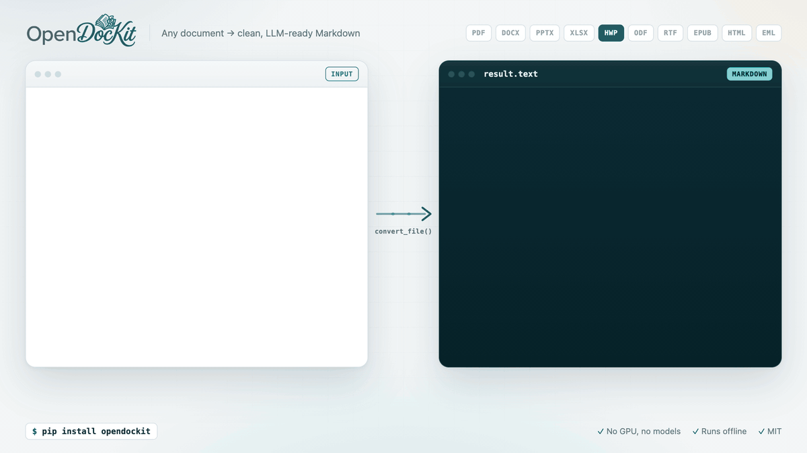
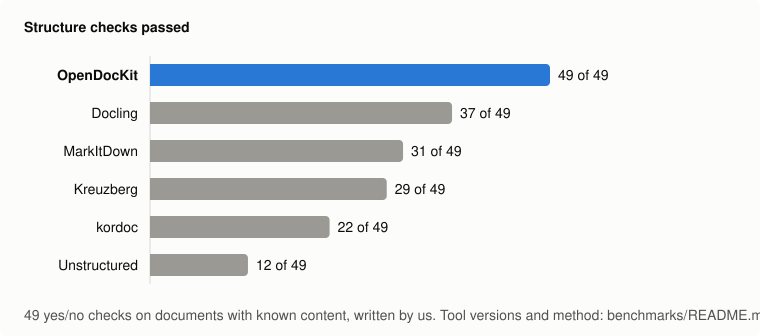
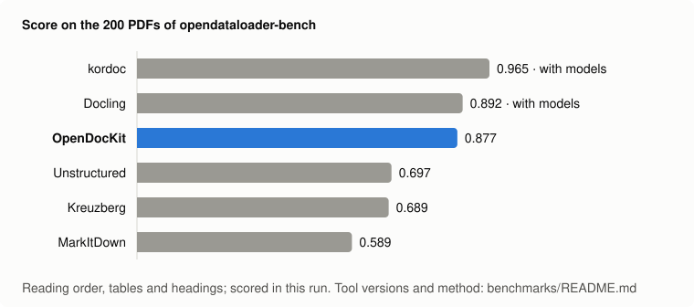
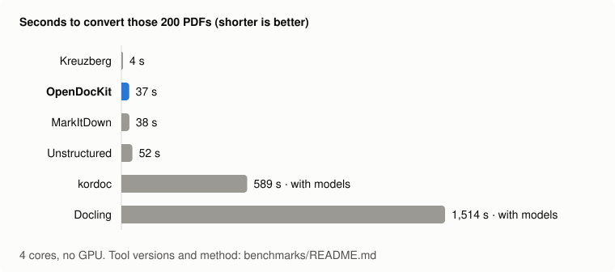

<h1 align="center">
  <picture>
    <source media="(prefers-color-scheme: dark)" srcset="https://raw.githubusercontent.com/hyeonsang010716/OpenDocKit/main/docs/assets/banner-dark.png">
    
  </picture>
</h1>

<p align="center">
  <b>把任何文档转换成干净、可直接交给 LLM 的 Markdown。</b><br>
  PDF · DOCX · PPTX · XLSX · HWP/HWPX · ODF · RTF · EPUB · HTML · 电子邮件 · 图片 —— 一个函数，无需 GPU，MIT 许可证。
</p>

<p align="center">
  <a href="https://pypi.org/project/opendockit/"></a>
  <a href="https://pypi.org/project/opendockit/"></a>
  <a href="https://github.com/hyeonsang010716/OpenDocKit/actions/workflows/ci.yml"></a>
  <a href="https://github.com/hyeonsang010716/OpenDocKit/blob/main/LICENSE"></a>
  <a href="https://github.com/NousResearch/hermes-agent/blob/main/plugin-catalog/opendockit.yaml"></a>
  <a href="https://marketplace.dify.ai/plugin/hyeonsang010716/opendockit"></a>
</p>

<p align="center">
  <a href="https://github.com/hyeonsang010716/OpenDocKit/blob/main/README.md">English</a> ·
  <a href="https://github.com/hyeonsang010716/OpenDocKit/blob/main/README.ko.md">한국어</a> ·
  <b>简体中文</b>
</p>

---

<p align="center">
  <picture>
    <source media="(prefers-color-scheme: dark)" srcset="https://raw.githubusercontent.com/hyeonsang010716/OpenDocKit/main/docs/assets/demo-dark.gif">
    
  </picture>
</p>

```python
from opendockit import convert_file

result = convert_file("quarterly-report.hwp")

result.text        # Markdown：标题、表格、列表、脚注、LaTeX 公式
result.sections    # 按页 / 幻灯片 / 工作表划分 —— 用于分块和标注出处（“第 3 页”）
result.warnings    # 被跳过或近似处理的内容，用平实的句子说明
```

## 为什么选择 OpenDocKit

大多数转换工具只照顾理想情况。OpenDocKit 面向的是人们实际上传的文件。

- **保留结构，而不只是文字。** 合并单元格、多栏 PDF、无边框表格、嵌套列表、脚注和演讲者备注都会保留；
  原生图表转成数据表，SmartArt 转成嵌套列表，Word / PowerPoint / Hancom（韩文办公软件）的公式转成 LaTeX，
  链接和粗体 / 斜体转成 Markdown。
- **对韩文文档提供一流支持。** 从零实现的 HWP 5.x 解析器、HWPX、CP949 编码检测、NFC 规范化，
  以及韩国办公环境中常见的表单式表格。大多数通用转换工具根本读不了这些文件。
- **按内容而不是扩展名识别格式。** 保存成 `.xls` 的 HTML 表格、带标题行的 CSV、命名为 `.doc` 的 MHTML 页面，
  都会按其真实格式读取，并给出一条警告告诉你。
- **可以安全处理不可信的上传文件。** 压缩炸弹、失控的合并单元格数量、递归的 PDF 对象以及数 GB 的图片都有上限。
  `IsolatedConverter` 让每个文件都在一次性的工作进程中转换，并带有内存和时间限制。
- **图片留在原位。** 图片、图表和扫描页面会被提取并筛选；接入视觉模型后，描述会写在它们在文档中原来的位置。
- **严格的字符预算。** `max_chars` 是让转换*停下来*，而不是转换完再截断，
  所以一个注定会被拒绝的文件既不会耗费解析时间，也不会产生视觉模型调用费用。
- **默认只依赖宽松许可证。** 采用 MIT 许可证；`pip install opendockit` 带来的所有依赖都是 MIT / BSD / Apache
  一类的许可证（没有 PyMuPDF，没有 pyhwp），不含机器学习模型，也不需要 GPU。唯一的 copyleft 代码在可选的
  `heic` 附加组件中。

支撑这些说法的数字，以及 OpenDocKit 不如别人的地方，都在[与其他工具的比较](#与其他工具的比较)里。

## 安装

```bash
pip install opendockit                # 仅转换 —— 完全不访问网络
pip install "opendockit[openai]"      # + 用视觉模型描述图片
pip install "opendockit[heic]"        # + HEIC/HEIF 图片（会安装 GPL/LGPL 许可证的编解码库）
pip install "opendockit[langchain]"   # + LangChain 加载器
pip install "opendockit[llamaindex]"  # + LlamaIndex 读取器
pip install "opendockit[lightrag]"    # + LightRAG 解析引擎
pip install "opendockit[mcp]"         # + 供智能体使用的 MCP 服务器
pip install "opendockit[open-webui]"  # + Open WebUI 文档加载器
```

需要 Python 3.12 或更高版本，运行在 Linux、macOS 或 Windows 上。在 Windows 上，超过 256 K 个字符或嵌套极深的格式错误 HTML 页面
或邮件正文会由较旧的解析器读取，可能丢失内容，并附带警告
（[原因](https://github.com/hyeonsang010716/OpenDocKit/blob/main/docs/limitations.md#platforms)）。

可选：如需读取旧版 `.doc` 和 `.ppt` 文件，请安装 [LibreOffice](https://www.libreoffice.org/)
（`brew install --cask libreoffice`、`apt install libreoffice`）。其他所有格式都由 OpenDocKit 自己读取。

## 快速开始

### 转换

```python
from opendockit import convert, convert_file

result = convert_file("report.pdf")              # 从路径读取
result = convert(data, "report.pdf")             # 从字节读取（文件名只是提示）

print(result.text)
print(result.char_count, result.exceeded)        # 输出的大小，以及是否因达到上限而停止
```

`convert` 是同步的、离线的，并且结果是确定的（唯一的例外：`.doc` 和 `.ppt` 会启动本地的 LibreOffice 进程）。
图片收集在 `result.images` 中，正文里每张图片原来的位置保留一个 `[Image]` 占位符。

### 用视觉模型描述图片

```python
from opendockit import OpenAIImageDescriber, aconvert

result = await aconvert(data, "report.pdf", describer=OpenAIImageDescriber())   # 读取 OPENAI_API_KEY
```

图表变成数据表，示意图变成列表，扫描页面被转写成文字，装饰性图片则被丢弃。
`OpenAIImageDescriber(model)` 接受任意 LangChain 聊天模型；任何带有 `async describe(image) -> str`
方法的对象都可以作为描述器。详见 [docs/images.md](https://github.com/hyeonsang010716/OpenDocKit/blob/main/docs/images.md)。

### 在服务器上使用

```python
from opendockit import ConversionError, IsolatedConverter

async with IsolatedConverter(workers=2) as converter:      # 默认每个文件 2 GB、2 分钟
    try:
        result = await converter.convert(data, filename)
    except ConversionError as exc:
        print(exc.code, exc)                               # 稳定的错误码 + 可以直接展示给用户的消息
```

一个有问题的文件只会结束一个工作进程，你的服务器和下一个上传照常运行。在脚本中请把这段代码放在
`if __name__ == "__main__":` 之下，因为工作进程会重新导入主模块。
详见 [docs/server.md](https://github.com/hyeonsang010716/OpenDocKit/blob/main/docs/server.md)。

### 命令行

```bash
opendockit report.pdf                 # Markdown 输出到标准输出，警告输出到标准错误
opendockit report.pdf --json          # 分节、元数据、警告、图片
opendockit report.pdf --count         # 只输出字符数
opendockit report.pdf -o report.md    # 直接写入文件（UTF-8；在 Windows PowerShell 中请用这种方式）
opendockit scan.pdf --describe        # 用视觉模型描述图片（使用 OPENAI_API_KEY）
```

### LangChain、LlamaIndex 和 MCP

```python
from opendockit.integrations.langchain import OpenDocKitLoader
from opendockit.integrations.llama_index import OpenDocKitReader

docs = OpenDocKitLoader("report.pdf", mode="sections").load()       # 每页 / 每张幻灯片 / 每个工作表一个 Document
docs = OpenDocKitReader(mode="sections").load_data("report.pdf")
```

```bash
opendockit-mcp --root ~/Documents     # MCP 服务器：让 Claude、Cursor 等智能体把你的文档读成 Markdown
```

如果想让客户端自行启动服务器、无需事先安装，请在客户端的 MCP 设置中加入：

```json
{
  "mcpServers": {
    "opendockit": {
      "command": "uvx",
      "args": ["opendockit-mcp", "--root", "/path/to/documents"]
    }
  }
}
```

使用 `mode="sections"` 时，每一页、每张幻灯片或每个工作表各成为一个 Document，其编号保存在元数据中，可用于标注出处。
详见 [docs/integrations.md](https://github.com/hyeonsang010716/OpenDocKit/blob/main/docs/integrations.md)。

[](https://glama.ai/mcp/servers/hyeonsang010716/OpenDocKit)

### Hermes Agent

OpenDocKit 已收录于 [Hermes Agent 插件目录](https://github.com/NousResearch/hermes-agent/tree/main/plugin-catalog)。目录中的每个插件都经过 Hermes 维护者审核，并固定到一个提交：

```bash
hermes plugins install opendockit
hermes plugins enable opendockit
```

之后在新会话中向 Hermes 询问本机上的文件即可。长文档按页、幻灯片或工作表分段读取，文档不会发送到任何地方，也不需要 API
密钥。插件在本机运行什么、如何限制它可读取的文件夹，见 [hermes-plugin/README.md](https://github.com/hyeonsang010716/OpenDocKit/blob/main/hermes-plugin/README.md)。

### Claude Code

本仓库就是该插件的插件市场，一行命令即可安装：

```text
/plugin install opendockit --marketplace hyeonsang010716/OpenDocKit
```

然后向 Claude 询问你电脑上的文档。它能读取 Read 工具打不开的 Word、PowerPoint、Excel 和 HWP/HWPX 文件，并按页读取较长的 PDF。插件运行的内容以及如何限制可读取的文件夹见
[claude-plugin/README.md](https://github.com/hyeonsang010716/OpenDocKit/blob/main/claude-plugin/README.md)。

### Dify

OpenDocKit 已上架 [Dify Marketplace](https://marketplace.dify.ai/plugin/hyeonsang010716/opendockit)，经过 Dify 维护者审核。在你的 Dify 中打开 **Plugins**，在 Marketplace 中找到
OpenDocKit 并安装。然后在 Workflow 或 Chatflow 中：

1. 在 **Start** 节点添加一个 **File** 变量。HWP 和 HWPX 需选择 **Other file types**，并添加 `.hwp` 和 `.hwpx`。
2. 添加工具 **OpenDocKit → Convert to Markdown**，把文件传给它。
3. 在 LLM 节点中使用 `text`，或使用每页、每张幻灯片或每个工作表一项的 `documents`。

Dify 本身无法读取 HWP 或 HWPX。文件在你自己的 Dify 中、在有内存和时间限制的工作进程里转换，不需要 API 密钥，也不会发送到任何其他地方。输出和限制见
[dify-plugin/README.md](https://github.com/hyeonsang010716/OpenDocKit/blob/main/dify-plugin/README.md)。

### Open WebUI

`opendockit-open-webui` 是用于 Open WebUI **External** 内容提取引擎的文档加载器。Open WebUI 把每个上传的文件发给它，
并按每页、每张幻灯片或每个工作表索引一个文档；来自 PDF 的引用会标出并打开正确的页面。Open WebUI 本身无法读取 HWP 或 HWPX。

```bash
pip install "opendockit[open-webui]"
export OPENDOCKIT_OPEN_WEBUI_API_KEY=$(openssl rand -hex 32)
opendockit-open-webui --host 0.0.0.0     # then in Open WebUI: Documents → External, this URL and the same key
```

在 **Admin Settings → Documents** 中把 **Content Extraction Engine** 设为 **External**，填入加载器的 URL 和相同的 API
密钥。每个文件都在有内存和时间限制的工作进程中离线转换。Docker Compose、限制和错误见
[docs/integrations.md](https://github.com/hyeonsang010716/OpenDocKit/blob/main/docs/integrations.md#open-webui-document-loader)。

## 支持的格式

| 格式 | 分节单位 | 要点 |
| --- | --- | --- |
| PDF | 页 | 跨栏的阅读顺序、有线表格和无边框表格、表单字段的值、根据字号和字重推断标题、去除重复的页眉 / 页脚、在页面证据确凿时链接脚注、扫描页面交给视觉模型 |
| DOCX | 文档 | 标题样式、列表编号、合并单元格、图表 → 表格、SmartArt、脚注 / 尾注、公式 → LaTeX、批注 |
| PPTX | 幻灯片 | 按屏幕上的顺序、项目符号层级、表格、图表 → 表格、SmartArt、公式、演讲者备注 |
| XLSX · XLS · Excel 2003 XML · CSV | 工作表 | 一张工作表中的多个表格、合并单元格、数字和日期格式、图表、单元格批注 |
| HWP · HWPX | 文档 | 大纲标题、段落编号、合并单元格、题注、脚注、公式 → LaTeX |
| ODT · ODS · ODP | 文档 / 工作表 / 幻灯片 | 直接读取文件包：标题、列表、合并单元格、图表、公式 → LaTeX、演讲者备注 |
| RTF | 文档 | 内置解析器：旧式代码页（CP949）、带合并单元格的表格、列表、脚注、图片 |
| EPUB | 文档 | 按阅读顺序排列的章节、书中内嵌的图片、元数据 |
| DOC · PPT | 文档 / 幻灯片 | 安装了 LibreOffice 时通过它转换，然后按 DOCX / PPTX 读取 |
| HTML · MHTML | 文档 | 带 rowspan/colspan 的表格、展开布局用表格、MathML → LaTeX、移除隐藏元素 |
| 电子邮件（`.eml`、mbox） | 文档 | 邮件头、HTML 或纯文本正文、转发的邮件、日历邀请 |
| TXT · Markdown | 文档 | 编码检测（UTF-8、CP949、UTF-16、Windows-1252） |
| 图片 | 文档 / 页 | JPEG、PNG、WebP、GIF、BMP、TIFF、AVIF，以及通过 `heic` 附加组件支持的 HEIC —— 由视觉模型描述 |

旧版 `.doc` 和 `.ppt` 需要安装 LibreOffice，其余格式都由 OpenDocKit 自己读取。每种格式能还原哪些内容，见
[docs/formats.md](https://github.com/hyeonsang010716/OpenDocKit/blob/main/docs/formats.md)；它做不到的事情，如实列在
[docs/limitations.md](https://github.com/hyeonsang010716/OpenDocKit/blob/main/docs/limitations.md) 中。

## 与其他工具的比较

<p align="center">
  
</p>

我们在没有 GPU 的 4 核标准 GitHub runner 上，用同一批文件运行了 OpenDocKit、MarkItDown、Kreuzberg、Unstructured、
Docling 和 kordoc。测试方法、全部原始结果以及重新运行的步骤都在[完整报告](https://github.com/hyeonsang010716/OpenDocKit/blob/main/benchmarks/README.md)里。

|  | OpenDocKit | MarkItDown | Kreuzberg | Unstructured | Docling | kordoc |
| --- | :---: | :---: | :---: | :---: | :---: | :---: |
| 能读取的格式（共 31 种） | **26** | 19 | 22 | 24 | 22 | 11 |
| HWP 和 HWPX | ✅ | ❌ | ❌ | ❌ | ❌ | ✅ |
| 通过的结构检查（共 49 项，由我们编写） | **49** | 31 | 29 | 12 | 37 | 22 |
| PDF 基准得分（200 个文件，非我们编写） | 0.877 | 0.589 | 0.689 | 0.697 | 0.892 | **0.965** |
| 转换这 200 个 PDF 的秒数 | 37 | 38 | **4** | 52 | 1,514 | 589 |
| 期间的内存峰值（MB） | 222 | 310 | **82** | 2,127 | 3,023 | 1,309 |
| 安装体积（MB） | **103** | 337 | 5,792 | 6,746 | 5,987 | 670 |

- **不用模型，读得最广。** 在测试的 31 种格式中，OpenDocKit 只靠 CPU 就能读取 26 种，比其他工具都多，并且通过了
  全部 49 项结构检查，例如“合并单元格是否仍然属于它所在的行”。这些检查是我们自己写的，报告里说明了应当如何看待这一点。
- **PDF 上接近使用模型的工具，而耗时只是它们的零头。** opendataloader-bench 不是我们编写的基准，在它的 200 个 PDF
  上 OpenDocKit 得 0.877 分。kordoc（0.965）和 Docling（0.892）更高，但它们靠运行模型得到这个分数：处理这 200 个文件
  分别需要 589 秒和 1,514 秒，OpenDocKit 需要 37 秒。
- **HWP 和 HWPX。** 只有 OpenDocKit 和 kordoc 能读。kordoc 在 PDF 上领先，还能在本机识别扫描件；OpenDocKit 则在
  Python 里用同一个函数读取其余格式。
- **为接收陌生人上传的文件而设计。** 面对 113 个模糊测试发现的文件和攻击文件，它没有崩溃也没有卡死，进程占用的内存
  最高为 97 MB。其中一个文件让另外 2 个工具的内存超过了 6 GB。
- **不足之处。** 它没有 OCR：扫描件和图片需要视觉模型，而 Docling、Unstructured 和 kordoc 可以在本机读取。表格是它在
  PDF 上最弱的一项（0.776，kordoc 为 0.981）。Kreuzberg 在各方面都快得多，旧版 `.doc` / `.ppt` 需要经过 LibreOffice。

<p align="center">
  
  
</p>

## 示例

[`examples/`](https://github.com/hyeonsang010716/OpenDocKit/tree/main/examples/) 中为每种格式准备了一个示例文档，
以及 OpenDocKit 由它生成的 Markdown（分别是使用和不使用视觉模型的结果），你可以在安装之前先判断输出质量。

## 文档

以下文档均为英文。

| | |
| --- | --- |
| [格式](https://github.com/hyeonsang010716/OpenDocKit/blob/main/docs/formats.md) | 每种格式提取哪些内容，以及如何呈现 |
| [选项](https://github.com/hyeonsang010716/OpenDocKit/blob/main/docs/options.md) | `ConvertOptions`、异常和错误码 |
| [图片](https://github.com/hyeonsang010716/OpenDocKit/blob/main/docs/images.md) | 提取、筛选、视觉模型、自定义描述器 |
| [在服务器上运行](https://github.com/hyeonsang010716/OpenDocKit/blob/main/docs/server.md) | `IsolatedConverter`、资源限制、字符预算 |
| [集成](https://github.com/hyeonsang010716/OpenDocKit/blob/main/docs/integrations.md) | LangChain、LlamaIndex、LightRAG、MCP 服务器、Hermes Agent、Claude Code、Dify 和 Open WebUI |
| [集成指南](https://github.com/hyeonsang010716/OpenDocKit/blob/main/docs/integration-guide.md) | 上传界面应该告诉用户什么 |
| [设计](https://github.com/hyeonsang010716/OpenDocKit/blob/main/docs/design.md) | 为什么这样设计，以及如何验证 |
| [局限](https://github.com/hyeonsang010716/OpenDocKit/blob/main/docs/limitations.md) | 已知的不足，如实说明 |
| [决策记录](https://github.com/hyeonsang010716/OpenDocKit/tree/main/docs/decisions/) | 每一个有意做出的取舍，以及固定它的测试 |

## 参与贡献

欢迎贡献 —— 附带最小复现文档的错误报告尤其有价值。
请先阅读 [CONTRIBUTING.md](https://github.com/hyeonsang010716/OpenDocKit/blob/main/CONTRIBUTING.md)。

```bash
git clone https://github.com/hyeonsang010716/OpenDocKit.git && cd OpenDocKit
uv sync
uv run pytest -n auto -m "not timing"   # 并行运行大部分测试
uv run pytest -m timing                  # 逐个运行测量时间的测试
uv run ruff check
```

## 许可证

[MIT](https://github.com/hyeonsang010716/OpenDocKit/blob/main/LICENSE)

---

本文档是 [README.md](https://github.com/hyeonsang010716/OpenDocKit/blob/main/README.md) 的简体中文翻译。
如有出入，以英文版为准。
