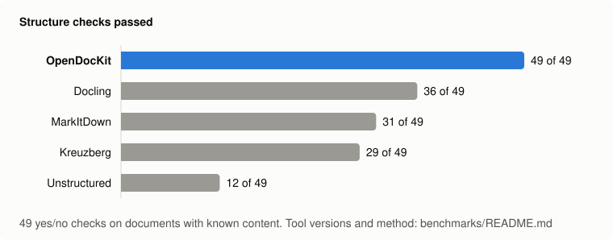

<h1 align="center">OpenDocKit</h1>

<p align="center">
  <b>把任何文档转换成干净、可直接交给 LLM 的 Markdown。</b><br>
  PDF · DOCX · PPTX · XLSX · HWP/HWPX · ODF · RTF · EPUB · HTML · 电子邮件 · 图片 —— 一个函数，无需 GPU，MIT 许可证。
</p>

<p align="center">
  <a href="https://pypi.org/project/opendockit/"></a>
  <a href="https://pypi.org/project/opendockit/"></a>
  <a href="https://github.com/hyeonsang010716/OpenDocKit/actions/workflows/ci.yml"></a>
  <a href="https://github.com/hyeonsang010716/OpenDocKit/blob/main/LICENSE"></a>
</p>

<p align="center">
  <a href="https://github.com/hyeonsang010716/OpenDocKit/blob/main/README.md">English</a> ·
  <a href="https://github.com/hyeonsang010716/OpenDocKit/blob/main/README.ko.md">한국어</a> ·
  <b>简体中文</b>
</p>

---

```python
from opendockit import convert_file

result = convert_file("quarterly-report.hwp")

result.text        # Markdown：标题、表格、列表、脚注、LaTeX 公式
result.sections    # 按页 / 幻灯片 / 工作表划分 —— 用于分块和标注出处（“第 3 页”）
result.warnings    # 被跳过或近似处理的内容，用平实的句子说明
```

## 为什么选择 OpenDocKit

大多数转换工具只照顾理想情况。OpenDocKit 面向的是人们实际上传的文件。

- **保留结构，而不只是文字。** 合并单元格、多栏 PDF、无边框表格、嵌套列表、脚注和演讲者备注都会保留；
  原生图表转成数据表，SmartArt 转成嵌套列表，Word / PowerPoint / Hancom（韩文办公软件）的公式转成 LaTeX，
  链接和粗体 / 斜体转成 Markdown。
- **对韩文文档提供一流支持。** 从零实现的 HWP 5.x 解析器、HWPX、CP949 编码检测、NFC 规范化，
  以及韩国办公环境中常见的表单式表格。大多数通用转换工具根本读不了这些文件。
- **按内容而不是扩展名识别格式。** 保存成 `.xls` 的 HTML 表格、带标题行的 CSV、命名为 `.doc` 的 MHTML 页面，
  都会按其真实格式读取，并给出一条警告告诉你。
- **可以安全处理不可信的上传文件。** 压缩炸弹、失控的合并单元格数量、递归的 PDF 对象以及数 GB 的图片都有上限。
  `IsolatedConverter` 让每个文件都在一次性的工作进程中转换，并带有内存和时间限制。
- **图片留在原位。** 图片、图表和扫描页面会被提取并筛选；接入视觉模型后，描述会写在它们在文档中原来的位置。
- **严格的字符预算。** `max_chars` 是让转换*停下来*，而不是转换完再截断，
  所以一个注定会被拒绝的文件既不会耗费解析时间，也不会产生视觉模型调用费用。
- **默认只依赖宽松许可证。** 采用 MIT 许可证；`pip install opendockit` 带来的所有依赖都是 MIT / BSD / Apache
  一类的许可证（没有 PyMuPDF，没有 pyhwp），不含机器学习模型，也不需要 GPU。唯一的 copyleft 代码在可选的
  `heic` 附加组件中。

## 安装

```bash
pip install opendockit                # 仅转换 —— 完全不访问网络
pip install "opendockit[openai]"      # + 用视觉模型描述图片
pip install "opendockit[heic]"        # + HEIC/HEIF 图片（会安装 GPL/LGPL 许可证的编解码库）
```

需要 Python 3.12 或更高版本，运行在 Linux 或 macOS 上。Windows 暂不支持 HTML、电子邮件和 EPUB
（[原因](https://github.com/hyeonsang010716/OpenDocKit/blob/main/docs/limitations.md#platforms)）。

可选：如需读取旧版 `.doc` 和 `.ppt` 文件，请安装 [LibreOffice](https://www.libreoffice.org/)
（`brew install --cask libreoffice`、`apt install libreoffice`）。其他所有格式都由 OpenDocKit 自己读取。

## 快速开始

### 转换

```python
from opendockit import convert, convert_file

result = convert_file("report.pdf")              # 从路径读取
result = convert(data, "report.pdf")             # 从字节读取（文件名只是提示）

print(result.text)
print(result.char_count, result.exceeded)        # 输出的大小，以及是否因达到上限而停止
```

`convert` 是同步的、离线的，并且结果是确定的（唯一的例外：`.doc` 和 `.ppt` 会启动本地的 LibreOffice 进程）。
图片收集在 `result.images` 中，正文里每张图片原来的位置保留一个 `[Image]` 占位符。

### 用视觉模型描述图片

```python
from opendockit import OpenAIImageDescriber, aconvert

result = await aconvert(data, "report.pdf", describer=OpenAIImageDescriber())   # 读取 OPENAI_API_KEY
```

图表变成数据表，示意图变成列表，扫描页面被转写成文字，装饰性图片则被丢弃。
`OpenAIImageDescriber(model)` 接受任意 LangChain 聊天模型；任何带有 `async describe(image) -> str`
方法的对象都可以作为描述器。详见 [docs/images.md](https://github.com/hyeonsang010716/OpenDocKit/blob/main/docs/images.md)。

### 在服务器上使用

```python
from opendockit import ConversionError, IsolatedConverter

async with IsolatedConverter(workers=2) as converter:      # 默认每个文件 2 GB、2 分钟
    try:
        result = await converter.convert(data, filename)
    except ConversionError as exc:
        print(exc.code, exc)                               # 稳定的错误码 + 可以直接展示给用户的消息
```

一个有问题的文件只会结束一个工作进程，你的服务器和下一个上传照常运行。在脚本中请把这段代码放在
`if __name__ == "__main__":` 之下，因为工作进程会重新导入主模块。
详见 [docs/server.md](https://github.com/hyeonsang010716/OpenDocKit/blob/main/docs/server.md)。

### 命令行

```bash
opendockit report.pdf                 # Markdown 输出到标准输出，警告输出到标准错误
opendockit report.pdf --json          # 分节、元数据、警告、图片
opendockit report.pdf --count         # 只输出字符数
opendockit scan.pdf --describe        # 用视觉模型描述图片（使用 OPENAI_API_KEY）
```

## 支持的格式

| 格式 | 分节单位 | 要点 |
| --- | --- | --- |
| PDF | 页 | 跨栏的阅读顺序、有线表格和无边框表格、表单字段的值、根据字号推断标题、去除重复的页眉 / 页脚、扫描页面交给视觉模型 |
| DOCX | 文档 | 标题样式、列表编号、合并单元格、图表 → 表格、SmartArt、脚注 / 尾注、公式 → LaTeX、批注 |
| PPTX | 幻灯片 | 按屏幕上的顺序、项目符号层级、表格、图表 → 表格、SmartArt、公式、演讲者备注 |
| XLSX · XLS · Excel 2003 XML · CSV | 工作表 | 一张工作表中的多个表格、合并单元格、数字和日期格式、图表、单元格批注 |
| HWP · HWPX | 文档 | 大纲标题、段落编号、合并单元格、题注、脚注、公式 → LaTeX |
| ODT · ODS · ODP | 文档 / 工作表 / 幻灯片 | 直接读取文件包：标题、列表、合并单元格、图表、公式 → LaTeX、演讲者备注 |
| RTF | 文档 | 内置解析器：旧式代码页（CP949）、带合并单元格的表格、列表、脚注、图片 |
| EPUB | 文档 | 按阅读顺序排列的章节、书中内嵌的图片、元数据 |
| DOC · PPT | 文档 / 幻灯片 | 安装了 LibreOffice 时通过它转换，然后按 DOCX / PPTX 读取 |
| HTML · MHTML | 文档 | 带 rowspan/colspan 的表格、展开布局用表格、MathML → LaTeX、移除隐藏元素 |
| 电子邮件（`.eml`、mbox） | 文档 | 邮件头、HTML 或纯文本正文、转发的邮件、日历邀请 |
| TXT · Markdown | 文档 | 编码检测（UTF-8、CP949、UTF-16、Windows-1252） |
| 图片 | 文档 / 页 | JPEG、PNG、WebP、GIF、BMP、TIFF、AVIF，以及通过 `heic` 附加组件支持的 HEIC —— 由视觉模型描述 |

旧版 `.doc` 和 `.ppt` 需要安装 LibreOffice，其余格式都由 OpenDocKit 自己读取。每种格式能还原哪些内容，见
[docs/formats.md](https://github.com/hyeonsang010716/OpenDocKit/blob/main/docs/formats.md)；它做不到的事情，如实列在
[docs/limitations.md](https://github.com/hyeonsang010716/OpenDocKit/blob/main/docs/limitations.md) 中。

## 与其他工具的比较

<p align="center">
  
</p>

我们在标准的 GitHub 运行器上，用同一批文件运行了 OpenDocKit、MarkItDown、Kreuzberg、Unstructured 和 Docling
（[方法、原始结果以及如何重新运行](https://github.com/hyeonsang010716/OpenDocKit/blob/main/benchmarks/README.md)）：

- **结构** —— OpenDocKit 保留得最多：在“合并的单元格是否仍然属于它所在的行”这类检查中，49 项通过了 49 项，
  排在其后的工具通过 36 项。这些检查是我们自己设计的，而且 0.2.0 是在已知这些检查的情况下开发的；
  这意味着什么，报告里有说明。
- **格式** —— 在测试的 31 种格式中，有 26 种不需要任何模型或外部服务就能读取，是五个工具中最多的；
  它也是其中唯一能读取 HWP 和 HWPX 的工具。
- **不是最快的，也没有 OCR** —— 扫描件和图片只能通过视觉模型读取，而 Docling 和 Unstructured 可以离线读取。
  Kreuzberg 大约快三十倍；旧版 `.doc` / `.ppt` 因为要经过 LibreOffice，每个文件大约需要一秒。

## 示例

[`examples/`](https://github.com/hyeonsang010716/OpenDocKit/tree/main/examples/) 中为每种格式准备了一个示例文档，
以及 OpenDocKit 由它生成的 Markdown（分别是使用和不使用视觉模型的结果），你可以在安装之前先判断输出质量。

## 文档

以下文档均为英文。

| | |
| --- | --- |
| [格式](https://github.com/hyeonsang010716/OpenDocKit/blob/main/docs/formats.md) | 每种格式提取哪些内容，以及如何呈现 |
| [选项](https://github.com/hyeonsang010716/OpenDocKit/blob/main/docs/options.md) | `ConvertOptions`、异常和错误码 |
| [图片](https://github.com/hyeonsang010716/OpenDocKit/blob/main/docs/images.md) | 提取、筛选、视觉模型、自定义描述器 |
| [在服务器上运行](https://github.com/hyeonsang010716/OpenDocKit/blob/main/docs/server.md) | `IsolatedConverter`、资源限制、字符预算 |
| [集成指南](https://github.com/hyeonsang010716/OpenDocKit/blob/main/docs/integration-guide.md) | 上传界面应该告诉用户什么 |
| [设计](https://github.com/hyeonsang010716/OpenDocKit/blob/main/docs/design.md) | 为什么这样设计，以及如何验证 |
| [局限](https://github.com/hyeonsang010716/OpenDocKit/blob/main/docs/limitations.md) | 已知的不足，如实说明 |
| [决策记录](https://github.com/hyeonsang010716/OpenDocKit/tree/main/docs/decisions/) | 每一个有意做出的取舍，以及固定它的测试 |

## 参与贡献

欢迎贡献 —— 附带最小复现文档的错误报告尤其有价值。
请先阅读 [CONTRIBUTING.md](https://github.com/hyeonsang010716/OpenDocKit/blob/main/CONTRIBUTING.md)。

```bash
git clone https://github.com/hyeonsang010716/OpenDocKit.git && cd OpenDocKit
uv sync
uv run pytest -n auto -m "not timing"   # 并行运行大部分测试
uv run pytest -m timing                  # 逐个运行测量时间的测试
uv run ruff check
```

## 许可证

[MIT](https://github.com/hyeonsang010716/OpenDocKit/blob/main/LICENSE)

---

本文档是 [README.md](https://github.com/hyeonsang010716/OpenDocKit/blob/main/README.md) 的简体中文翻译。
如有出入，以英文版为准。
