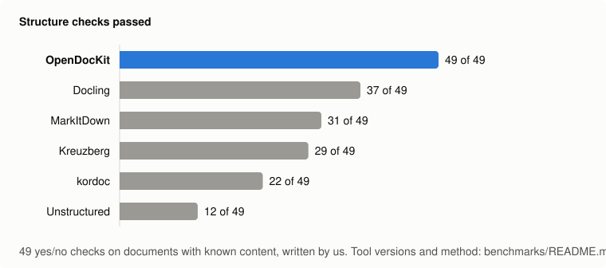
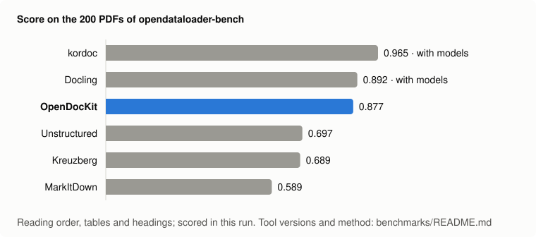
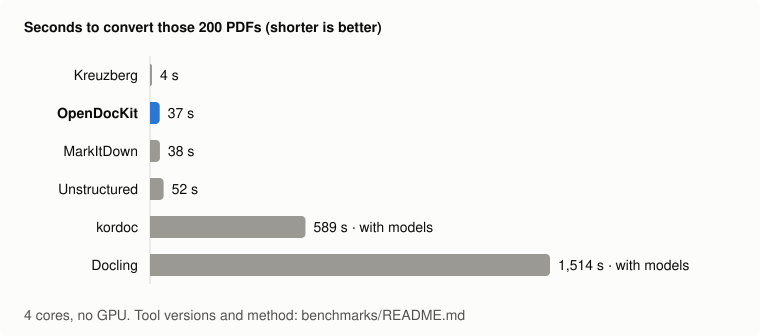
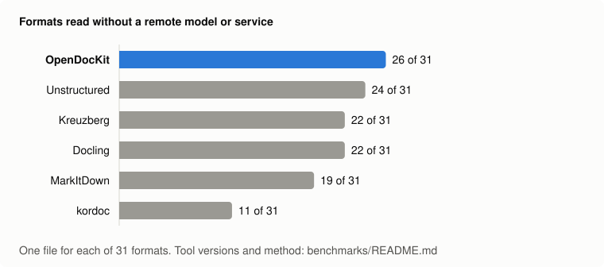
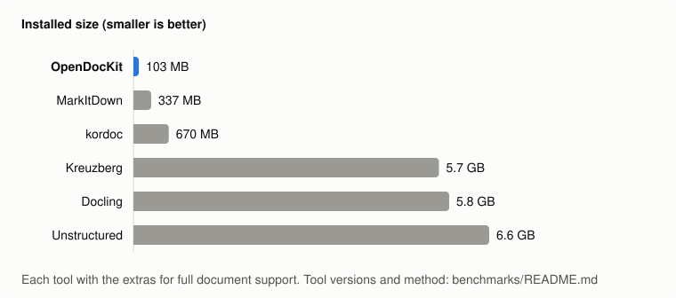

# Benchmark: OpenDocKit and five other document converters

OpenDocKit, [MarkItDown](https://github.com/microsoft/markitdown), [Kreuzberg](https://kreuzberg.dev),
[Unstructured](https://github.com/Unstructured-IO/unstructured), [Docling](https://github.com/docling-project/docling)
and [kordoc](https://github.com/chrisryugj/kordoc) were given the same files on the same machine. This page reports
what came out, including the places where OpenDocKit is not the best choice.

> **Read this first.** OpenDocKit's maintainers wrote this benchmark, so treat it as you would any vendor's. Sections 1
> and 2 use documents and checks we made. Section 3 uses a PDF benchmark we did not make, and sections 4 and 5 use
> other projects' test files. A program does the scoring and the results are saved in [`results/`](results/).
> Everything needed to rerun it on a free GitHub runner is in this folder. If a check is unfair to a tool, or a tool
> was set up badly, please open an issue and we will fix the benchmark.

## Summary

- **Formats.** OpenDocKit reads 26 of the 31 formats tested (31 with a vision model for images
  and scans). That is the most of the six. Without a model it does not read PDF (scanned, no text layer), Image (.png), Image (.jpg), Image (multi-page .tiff), Image (.heic): it has no OCR of its own.
- **Structure.** Of 49 yes/no checks such as "is the merged cell still attached to its row", OpenDocKit passes
  49 and the next tool, Docling, passes 37. The checks are ours; section 2 says how to read that.
- **PDF, on a benchmark we did not write.** On the 200 PDFs of
  [opendataloader-bench](https://github.com/opendataloader-project/opendataloader-bench), kordoc scores highest
  (0.965), Docling 0.892 and OpenDocKit 0.877. kordoc and Docling run models: kordoc needed
  589 s and Docling 1,514 s for the 200 files, OpenDocKit 37 s. Where
  OpenDocKit loses is tables (0.776 against 0.981 and 0.925).
- **Korean documents.** OpenDocKit and kordoc read HWP and HWPX; the other four do not.
- **Speed.** Kreuzberg is in a class of its own (6 s for 743 real files). OpenDocKit takes
  202 s, of which 123 s is LibreOffice converting 200 legacy `.doc` and `.ppt` files;
  MarkItDown 119 s, kordoc 323 s, Unstructured 491 s and Docling
  2,557 s on a machine without a GPU.
- **Hostile input.** On 113 fuzzer findings and attack files, MarkItDown and Unstructured went past the 6 GB cap on one file; kordoc ran into the 60-second limit on one. OpenDocKit, Kreuzberg and Docling got
  through all of them; OpenDocKit's largest process was 97 MB.
- **Footprint.** OpenDocKit installs 103 MB in 21 packages and downloads no model.











## What was compared

| Tool | Version | Installed as | License |
| :--- | :--- | :--- | :--- |
| [OpenDocKit](https://github.com/hyeonsang010716/OpenDocKit) | 0.3.15 | `opendockit[heic]` | MIT |
| [MarkItDown](https://github.com/microsoft/markitdown) | 0.1.9 | `markitdown[all]` | MIT |
| [Kreuzberg](https://kreuzberg.dev) | 4.10.4 | `kreuzberg[all]` | MIT |
| [Unstructured](https://github.com/Unstructured-IO/unstructured) | 0.27.37 | `unstructured[all-docs]` | Apache-2.0 |
| [Docling](https://github.com/docling-project/docling) | 2.151.1 | `docling` + `docling-slim[format-opendocument,format-office,format-email]` | MIT |
| [kordoc](https://github.com/chrisryugj/kordoc) | 4.25.3 | `npm install kordoc` | MIT |

Each Python tool was installed in its own virtual environment with the extras its documentation lists for full
document support, and kordoc with `npm install` (see [`setup_tools.sh`](setup_tools.sh)). Each was called through its
default entry point with default options (see [`adapters.py`](adapters.py) and
[`worker_kordoc.mjs`](worker_kordoc.mjs)). No tool was given an API key or a remote model. The system packages that
Unstructured and Kreuzberg use for OCR and legacy formats (Tesseract with English and Korean data, LibreOffice,
pandoc, Poppler, libmagic) were installed for everyone.

Machine: GitHub-hosted runner, Intel(R) Xeon(R) 6975P-C, 4 cores, 15 GB RAM, no GPU, Linux-7.0.0-1016-aws-x86_64-with-glibc2.43. Run from commit `c3b09d7`;
OpenDocKit was built from the commit above (0.3.15 plus what has been merged since).

## 1. Which formats does each tool read?

One representative file per format. ✅ means the output contains every piece of text we looked for; 🟡 some of it;
❌ none, an error, or an empty result. The documents are in [`cases/`](cases/) and the expected strings in
[`probes.py`](probes.py).

| Format | OpenDocKit | … + vision model | MarkItDown | Kreuzberg | Unstructured | Docling | kordoc |
| :--- | :---: | :---: | :---: | :---: | :---: | :---: | :---: |
| **Office** |  |  |  |  |  |  |  |
| Word (.docx) | ✅ |  | ✅ | ✅ | ✅ | ✅ | ✅ |
| PowerPoint (.pptx) | ✅ |  | ✅ | ✅ | ✅ | ✅ | ✅ |
| Excel (.xlsx) | ✅ |  | ✅ | ✅ | ✅ | ✅ | ✅ |
| Excel 97-2003 (.xls) | ✅ |  | ✅ | ✅ | ✅ | ✅ | ✅ |
| Excel 2003 XML | ✅ |  | ✅ | ✅ | ✅ | ❌ | ❌ |
| Word 97-2003 (.doc) | ✅ |  | ❌ | ✅ | ✅ | ✅ | ❌ |
| PowerPoint 97-2003 (.ppt) | ✅ |  | ❌ | ✅ | ✅ | ✅ | ❌ |
| Rich Text (.rtf) | ✅ |  | ✅ | ✅ | ✅ | ✅ | ❌ |
| OpenDocument Text (.odt) | ✅ |  | ❌ | ✅ | ✅ | ✅ | ❌ |
| OpenDocument Spreadsheet (.ods) | ✅ |  | ❌ | ✅ | ❌ | ✅ | ❌ |
| OpenDocument Presentation (.odp) | ✅ |  | ❌ | ❌ | ❌ | ✅ | ❌ |
| **Korean office** |  |  |  |  |  |  |  |
| Hangul (.hwp) | ✅ |  | ❌ | ❌ | ❌ | ❌ | ✅ |
| Hangul (.hwpx) | ✅ |  | ❌ | ❌ | ❌ | ❌ | ✅ |
| CSV in CP949 | ✅ |  | ✅ | ✅ | ❌ | 🟡 | ❌ |
| Text in CP949 | ✅ |  | ✅ | ❌ | ✅ | ❌ | ❌ |
| **PDF** |  |  |  |  |  |  |  |
| PDF (text) | ✅ |  | ✅ | ✅ | ✅ | ✅ | ✅ |
| PDF (scanned, no text layer) | ❌ | ✅ | ❌ | ❌ | ✅ | ✅ | ✅ |
| **Web and mail** |  |  |  |  |  |  |  |
| HTML | ✅ |  | ✅ | ✅ | ✅ | ✅ | ❌ |
| MHTML (.mht) | ✅ |  | ✅ | ✅ | ✅ | ✅ | ❌ |
| Email (.eml) | ✅ |  | ✅ | ✅ | ❌ | ✅ | ❌ |
| Mailbox (.mbox) | ✅ |  | ✅ | ❌ | ❌ | ❌ | ❌ |
| **Text and data** |  |  |  |  |  |  |  |
| Plain text | ✅ |  | ✅ | ✅ | ✅ | ✅ | ❌ |
| Markdown | ✅ |  | ✅ | ✅ | ✅ | ✅ | ❌ |
| CSV | ✅ |  | ✅ | ✅ | ✅ | ✅ | ❌ |
| Jupyter notebook | ✅ |  | ✅ | ✅ | ✅ | ❌ | ❌ |
| EPUB | ✅ |  | ✅ | ✅ | ✅ | ✅ | ❌ |
| **Images** |  |  |  |  |  |  |  |
| Image (.png) | ❌ | ✅ | ❌ | ✅ | ✅ | ✅ | ✅ |
| Image (.jpg) | ❌ | ✅ | ❌ | ✅ | ✅ | ✅ | ✅ |
| Image (multi-page .tiff) | ❌ | ✅ | ❌ | 🟡 | ✅ | ✅ | ✅ |
| Image (.heic) | ❌ | ✅ | ❌ | ❌ | ✅ | ❌ | ❌ |
| **Mislabeled** |  |  |  |  |  |  |  |
| HTML table saved as .xls | ✅ |  | ✅ | ❌ | ✅ | 🟡 | ❌ |
| **Formats read** | **26** | **31** | **19** | **22** | **24** | **22** | **11** |

Notes:

- The "… + vision model" column is OpenDocKit with `OpenAIImageDescriber`, run separately
  ([`vision_cases.py`](vision_cases.py)) and not repeated for this report: it was last run with OpenDocKit 0.2.0 + gpt-5.6-terra. It needs
  an API key and costs money, while the tools that read images here do their OCR on the machine for free. Compare
  like with like: without a model, OpenDocKit does not read images or scans.
- kordoc is a converter for Korean office documents and says so. It reads HWP, HWPX, PDF, the Office formats and
  images, and was not built for the rest of this list.
- Not tested, and supported by some of the other tools but not by OpenDocKit: audio and video, YouTube and web URLs,
  ZIP archives, Outlook `.msg`, Apple Pages/Numbers/Keynote, LaTeX, XBRL.
- A ✅ here only says the text came through. How well the structure survived is the next section.

## 2. How much of the structure survives?

49 yes/no questions about documents whose content we know exactly, because we generated them
([`make_cases.py`](make_cases.py)). Each question is a few lines of code in [`probes.py`](probes.py); matching ignores
case, whitespace, Markdown escapes and emphasis markers, and accepts both Markdown and HTML tables.

| Checks | OpenDocKit | MarkItDown | Kreuzberg | Unstructured | Docling | kordoc |
| :--- | :---: | :---: | :---: | :---: | :---: | :---: |
| Word (11) | **11** | 9 | 9 | 4 | **11** | 8 |
| PowerPoint (5) | **5** | 4 | 3 | 2 | 4 | 4 |
| Excel (6) | **6** | 2 | 2 | 1 | 4 | 3 |
| PDF (6) | **6** | 2 | 3 | 1 | **6** | 4 |
| HTML (10) | **10** | 7 | 9 | 3 | 9 | 0 |
| Email (5) | **5** | **5** | 2 | 0 | 3 | 0 |
| Korean documents (5) | **5** | 1 | 1 | 0 | 0 | 3 |
| Mislabeled file (1) | **1** | **1** | 0 | **1** | 0 | 0 |
| **All (49)** | **49** | 31 | 29 | 12 | 37 | 22 |

OpenDocKit passes all 49. Read that with the note on author bias at the end of this page in mind.

These are the same 49 checks, unchanged, that were published with the report for OpenDocKit 0.1.0, which passed 43
of them. Every release since was written with the checks known, so the score says those gaps are closed. It does not
say OpenDocKit would do as well on checks somebody else wrote; section 3 is the closest this page comes to that.

<details>
<summary>Every check, every tool</summary>

| Check | Document | OpenDocKit | MarkItDown | Kreuzberg | Unstructured | Docling | kordoc |
| :--- | :---: | :---: | :---: | :---: | :---: | :---: | :---: |
| Section titles are Markdown headings | `report.docx` | ✅ | ✅ | ✅ | ✅ | ✅ | ✅ |
| Bulleted list items are list items | `report.docx` | ✅ | ✅ | ❌ | ❌ | ✅ | ✅ |
| Numbered steps keep their numbers | `report.docx` | ✅ | ✅ | ❌ | ✅ | ✅ | ✅ |
| The table is a table (a row holds North, 150, 170) | `report.docx` | ✅ | ✅ | ✅ | ✅ | ✅ | ✅ |
| The vertically merged 'Domestic' cell still applies to the South row | `report.docx` | ✅ | ❌ | ✅ | ✅ | ✅ | ✅ |
| The equation is written as LaTeX | `report.docx` | ✅ | ❌ | ✅ | ❌ | ✅ | ✅ |
| The picture leaves a marker between the text before and after it | `report.docx` | ✅ | ✅ | ✅ | ❌ | ✅ | ✅ |
| A hyperlink keeps its address | `rich-text.docx` | ✅ | ✅ | ✅ | ❌ | ✅ | ✅ |
| Bold text stays bold | `rich-text.docx` | ✅ | ✅ | ✅ | ❌ | ✅ | ❌ |
| Italic text stays italic | `rich-text.docx` | ✅ | ✅ | ✅ | ❌ | ✅ | ❌ |
| Page header and footer text is kept out of the body | `rich-text.docx` | ✅ | ✅ | ✅ | ❌ | ✅ | ❌ |
| Each slide title is a heading | `deck.pptx` | ✅ | ✅ | ✅ | ✅ | ✅ | ✅ |
| A second-level bullet is visibly nested under its parent | `deck.pptx` | ✅ | ❌ | ✅ | ❌ | ✅ | ✅ |
| Speaker notes are included | `deck.pptx` | ✅ | ✅ | ❌ | ❌ | ❌ | ✅ |
| The slide table is a table | `deck.pptx` | ✅ | ✅ | ✅ | ✅ | ✅ | ✅ |
| The native chart becomes its numbers (Week 4: 8100 and 1650 in one row) | `deck.pptx` | ✅ | ✅ | ❌ | ❌ | ✅ | ❌ |
| Cell values come out as a table | `sales.xlsx` | ✅ | ✅ | ✅ | ✅ | ✅ | ✅ |
| The second table on the sheet is its own table, with its own header row | `sales.xlsx` | ✅ | ❌ | ❌ | ❌ | ❌ | ❌ |
| Percentages read as Excel shows them (46.4%) | `sales.xlsx` | ✅ | ❌ | ❌ | ❌ | ✅ | ❌ |
| Dates read as dates, without a spurious time | `sales.xlsx` | ✅ | ❌ | ❌ | ❌ | ✅ | ✅ |
| The second sheet is included and named | `sales.xlsx` | ✅ | ✅ | ✅ | ❌ | ❌ | ✅ |
| A hidden sheet is left out | `sales.xlsx` | ✅ | ❌ | ❌ | ❌ | ✅ | ❌ |
| Headings are detected from the layout | `service-report.pdf` | ✅ | ❌ | ✅ | ❌ | ✅ | ❌ |
| The ruled table is a table with all five columns in a row | `service-report.pdf` | ✅ | ✅ | ❌ | ❌ | ✅ | ✅ |
| The table without borders is still a table | `service-report.pdf` | ✅ | ✅ | ❌ | ❌ | ✅ | ✅ |
| The header repeated on every page is not repeated in the output | `service-report.pdf` | ✅ | ❌ | ✅ | ❌ | ✅ | ✅ |
| Page-number lines are removed | `service-report.pdf` | ✅ | ❌ | ✅ | ❌ | ✅ | ❌ |
| Two-column pages are read down the left column, then the right | `service-report.pdf` | ✅ | ❌ | ❌ | ✅ | ✅ | ✅ |
| Navigation, script and footer boilerplate is dropped | `article.html` | ✅ | ❌ | ✅ | ✅ | ✅ | ❌ |
| Hidden elements are dropped | `article.html` | ✅ | ❌ | ✅ | ❌ | ✅ | ❌ |
| A two-row header with rowspan/colspan still labels the columns | `article.html` | ✅ | ✅ | ✅ | ✅ | ✅ | ❌ |
| The nested list keeps its nesting | `article.html` | ✅ | ✅ | ✅ | ❌ | ✅ | ❌ |
| The code block is fenced | `article.html` | ✅ | ✅ | ✅ | ❌ | ✅ | ❌ |
| MathML is written as LaTeX | `article.html` | ✅ | ❌ | ❌ | ❌ | ❌ | ❌ |
| A hyperlink keeps its address | `rich-text.html` | ✅ | ✅ | ✅ | ❌ | ✅ | ❌ |
| Bold text stays bold | `rich-text.html` | ✅ | ✅ | ✅ | ❌ | ✅ | ❌ |
| Italic text stays italic | `rich-text.html` | ✅ | ✅ | ✅ | ❌ | ✅ | ❌ |
| An image's alt text is kept | `rich-text.html` | ✅ | ✅ | ✅ | ✅ | ✅ | ❌ |
| Subject, sender and recipient are kept | `meeting.eml` | ✅ | ✅ | ✅ | ❌ | ✅ | ❌ |
| The body is read once (not the HTML and the plain-text copy) | `meeting.eml` | ✅ | ✅ | ✅ | ❌ | ✅ | ❌ |
| The table in the HTML body is a table | `meeting.eml` | ✅ | ✅ | ❌ | ❌ | ❌ | ❌ |
| The meeting invitation's place and time are readable | `meeting.eml` | ✅ | ✅ | ❌ | ❌ | ✅ | ❌ |
| Both mails of the mailbox are read, in order | `mailbox.mbox` | ✅ | ✅ | ❌ | ❌ | ❌ | ❌ |
| The HWP table is a table | `table.hwp` | ✅ | ❌ | ❌ | ❌ | ❌ | ✅ |
| The HWPX table is a table | `score-table.hwpx` | ✅ | ❌ | ❌ | ❌ | ❌ | ✅ |
| Multi-level numbering is kept (3.1., 가.) | `numbered-outline.hwpx` | ✅ | ❌ | ❌ | ❌ | ❌ | ✅ |
| A CP949 CSV is decoded and its rows are a table | `branch-sales-cp949.csv` | ✅ | ✅ | ✅ | ❌ | ❌ | ❌ |
| Title lines above the header row do not become the header | `branch-sales-cp949.csv` | ✅ | ❌ | ❌ | ❌ | ❌ | ❌ |
| An HTML table named .xls is read as the table it is | `html-table-named.xls` | ✅ | ✅ | ❌ | ✅ | ❌ | ❌ |

</details>

Some checks encode an opinion about what is right for LLM input rather than a fact about the document: dropping
navigation and hidden elements, leaving hidden sheets out, removing running headers and page numbers, and showing a
cell the way Excel displays it (`46.4%`) instead of its stored value (`0.464459`). A tool that deliberately does the
opposite fails those checks by design, not by mistake.

## 3. A PDF benchmark we did not write

[opendataloader-bench](https://github.com/opendataloader-project/opendataloader-bench) is 200 PDFs, mostly English
reports and papers, each with a hand-checked Markdown reference. It scores reading order (NID), tables (TEDS,
42 documents have one) and headings (MHS, 107 documents), and averages the three. We ran all six
tools on those PDFs in this run and scored every output with the same program
([`score_pdfbench.py`](score_pdfbench.py), which calls OpenDocKit's scorer in [`evals/`](../evals/README.md); that
scorer was checked against the per-document scores the benchmark itself publishes).

| 200 PDFs | kordoc | Docling | OpenDocKit | Unstructured | Kreuzberg | MarkItDown |
| :--- | :---: | :---: | :---: | :---: | :---: | :---: |
| **Overall** | **0.965** | 0.892 | 0.877 | 0.697 | 0.689 | 0.589 |
| Reading order (NID) | **0.964** | 0.906 | 0.914 | 0.883 | 0.850 | 0.844 |
| Tables (TEDS) | **0.981** | 0.925 | 0.776 | 0.000 | 0.018 | 0.273 |
| Headings (MHS) | **0.953** | 0.830 | 0.805 | 0.427 | 0.479 | 0.000 |
| Words kept | **0.972** | 0.925 | 0.954 | 0.944 | 0.920 | 0.904 |
| Time for the 200 files, seconds | 589 | 1,514 | 37 | 52 | **4** | 38 |
| Peak memory, MB | 1,309 | 3,023 | 222 | 2,127 | **82** | 310 |
| Ran a model on these files | yes | yes | no | no | no | no |

- Every tool returned text for all 200.
- **kordoc is the best of the six here, and by a clear margin.** Docling is second and OpenDocKit third. kordoc and
  Docling read a page with models as well as with rules; OpenDocKit has only rules. That is most visible in the table
  row.
- **The price is time and memory.** kordoc took 16 times as long as OpenDocKit and Docling
  41 times, on a machine without a GPU; OpenDocKit stayed under 222 MB.
- **Two of these scores are not blind tests.** OpenDocKit keeps these 200 documents as a regression gate (no change
  may lower a mean, [`evals/README.md`](../evals/README.md)), and kordoc's
  [changelog](https://github.com/chrisryugj/kordoc/blob/main/docs/benchmarks.md) tracks them document by document, so
  both are likely to score higher here than on PDFs neither has seen. The benchmark is also English: it says little about Korean PDFs, which is what kordoc is built for.
- The benchmark's own leaderboard lists engines we did not run (OpenDataLoader, Marker, MinerU and others). Their
  published figures are in its README; the scores here are from this run only, with each tool's current version.
- OpenDocKit ran with page markers and image placeholders switched off, as in its own scorecard: they are marks it
  adds, not text of the document ([`adapters.py`](adapters.py)).

## 4. Real files from other projects

743 documents taken from the test suites of Apache POI, pdfplumber, hwplib and hwpxlib
([`corpus.py`](corpus.py) picks up to 100 per format at even intervals). Nobody here wrote or chose these files for a
particular tool. We do not know their correct output, so this section counts what happened, and then counts words.

| Returned text | OpenDocKit | MarkItDown | Kreuzberg | Unstructured | Docling | kordoc |
| :--- | :---: | :---: | :---: | :---: | :---: | :---: |
| DOCX (100) | 87 | 85 | 86 | 85 | 88 | **90** |
| PPTX (84) | **83** | **83** | 81 | 62 | 71 | 70 |
| XLSX (100) | 92 | 97 | 88 | 88 | 89 | **99** |
| XLS (100) | 91 | **99** | 86 | 84 | 87 | 97 |
| PDF (66) | **63** | 62 | 61 | **63** | 55 | 60 |
| HWP (44) | 29 | 0 | 0 | 0 | 0 | **41** |
| HWPX (49) | **40** | 0 | 0 | 0 | 0 | 38 |
| DOC (100) | 93 | 0 | 79 | 89 | **94** | 1 |
| PPT (100) | **90** | 0 | 77 | 82 | 83 | 0 |
| **All (743)** | **668** | **426** | **558** | **553** | **567** | **496** |

| Of the same files | OpenDocKit | MarkItDown | Kreuzberg | Unstructured | Docling | kordoc |
| :--- | :---: | :---: | :---: | :---: | :---: | :---: |
| Error (refused or failed) | 21 | 303 | 76 | 117 | 112 | 210 |
| No text returned | 54 | 14 | 109 | 73 | 55 | 36 |
| Timed out (120 s) | 0 | 0 | 0 | 0 | 9 | 1 |
| Crashed the process | 0 | 0 | 0 | 0 | 0 | 0 |

- "Returned text" means the result was not empty, nothing more. Many of these test files are blank pages, pictures or
  shapes, so "no text" is often the right answer: of the 93 Hangul files OpenDocKit returned text for
  69, and the rest state no text in their own records. kordoc returns a short placeholder for some of the same
  files, which this table counts as text. The word counts below are the fairer comparison.
- OpenDocKit reads legacy `.doc` and `.ppt` by handing them to LibreOffice, which this machine has: 183 of
  200 returned text. Without LibreOffice it refuses those two formats.
- Kreuzberg accepts `.hwp` files but returned no text for any of them.

### How many words of the source are in the output?

A DOCX, PPTX, XLSX or HWPX states its text in its own XML, and an HWP 5 file in its paragraph records. For every file
of the corpus that a tool returned text for, we looked up each word of the source in that tool's output
([`recall_corpus.py`](recall_corpus.py)). Nobody has to know the right Markdown for this.

| Words missing | OpenDocKit | MarkItDown | Kreuzberg | Unstructured | Docling | kordoc |
| :--- | :---: | :---: | :---: | :---: | :---: | :---: |
| DOCX (97 files) | 319 of 84,464 | 104 of 84,452 | 123 of 84,455 | 228 of 84,454 | 171 of 84,454 | 16 of 84,476 |
| PPTX (83 files) | 163 of 23,464 | 141 of 23,464 | 1,417 of 23,454 | 1,369 of 23,458 | 1,545 of 23,459 | 426 of 23,460 |
| XLSX (99 files) | 47 of 28,339 | 294 of 28,185 | 1 of 28,322 | 0 of 28,185 | 46 of 28,185 | 0 of 28,343 |
| HWPX (49 files) | 40 of 32,166 | reads none | reads none | reads none | reads none | 915 of 32,166 |
| HWP (43 files) | 35 of 297,600 | reads none | reads none | reads none | reads none | 43 of 297,606 |

A word left out on purpose counts exactly like a word that was lost, so the number needs the place beside it:

<details>
<summary>Where the missing words sit</summary>

| Format | Tool | Files it returned text for | Where the missing words sit in the source |
| :--- | :--- | :--- | :--- |
| DOCX | OpenDocKit | 87 | `document sdtContent/p/r/t` 134, `document tc/p/r/t` 85, `footer ftr/p/r/t` 37, `header hdr/p/r/t` 32, `header tc/p/r/t` 10, `footer tc/p/r/t` 7, `header sdt/sdtContent/r/t` 5, `document p/hyperlink/r/t` 4 |
| DOCX | MarkItDown | 85 | `footer ftr/p/r/t` 37, `header hdr/p/r/t` 32, `header tc/p/r/t` 10, `footer tc/p/r/t` 7, `header sdt/sdtContent/r/t` 5, `comments comment/p/r/t` 5, `document p/hyperlink/r/t` 2, `document txbxContent/p/r/t` 2 |
| DOCX | Kreuzberg | 86 | `footer ftr/p/r/t` 37, `header hdr/p/r/t` 32, `footnotes footnote/p/r/t` 14, `header tc/p/r/t` 10, `footer tc/p/r/t` 7, `header sdt/sdtContent/r/t` 5, `document p/hyperlink/r/t` 5, `comments comment/p/r/t` 5 |
| DOCX | Unstructured | 85 | `document sdtContent/p/r/t` 141, `footnotes footnote/p/r/t` 58, `document sdt/sdtContent/r/t` 6, `document txbxContent/p/r/t` 6, `comments comment/p/r/t` 5, `document tc/p/r/t` 3, `footer txbxContent/p/r/t` 2, `endnotes endnote/p/r/t` 2 |
| DOCX | Docling | 87 | `footnotes footnote/p/r/t` 58, `footer ftr/p/r/t` 37, `header hdr/p/r/t` 32, `header tc/p/r/t` 10, `footer tc/p/r/t` 7, `header sdt/sdtContent/r/t` 5, `comments comment/p/r/t` 5, `document body/p/r/t` 5 |
| DOCX | kordoc | 90 | `comments comment/p/r/t` 5, `endnotes endnote/p/r/t` 2, `footer sdtContent/p/r/t` 2, `document p/hyperlink/r/t` 2, `footer ftr/p/r/t` 1, `footer tc/p/r/t` 1, `endnotes sdt/sdtContent/r/t` 1, `footer p/fldSimple/r/t` 1 |
| PPTX | OpenDocKit | 83 | `notesSlide txBody/p/r/t` 97, `notesSlide txBody/p/fld/t` 47, `slide txBody/p/r/t` 19 |
| PPTX | MarkItDown | 83 | `notesSlide txBody/p/r/t` 94, `notesSlide txBody/p/fld/t` 47 |
| PPTX | Kreuzberg | 81 | `notesSlide txBody/p/r/t` 1,248, `notesSlide txBody/p/fld/t` 117, `slide txBody/p/fld/t` 52 |
| PPTX | Unstructured | 62 | `notesSlide txBody/p/r/t` 1,271, `notesSlide txBody/p/fld/t` 98 |
| PPTX | Docling | 71 | `notesSlide txBody/p/r/t` 1,270, `notesSlide txBody/p/fld/t` 131, `slide txBody/p/r/t` 89, `slide txBody/p/fld/t` 55 |
| PPTX | kordoc | 70 | `notesSlide txBody/p/r/t` 164, `notesSlide txBody/p/fld/t` 117, `slide txBody/p/r/t` 88, `slide txBody/p/fld/t` 57 |
| XLSX | OpenDocKit | 92 | `Sheet c[t=s]` 45, `sheet c[t=inlineStr]` 1, `sheet c[t=s]` 1 |
| XLSX | MarkItDown | 97 | `sheet c[t=s]` 294 |
| XLSX | Kreuzberg | 88 | `sheet c[t=inlineStr]` 1 |
| XLSX | Docling | 88 | `Sheet c[t=s]` 45, `sheet c[t=s]` 1 |
| HWPX | OpenDocKit | 40 | `section subList/p/run/t` 36, `section sec/p/run/t` 4 |
| HWPX | kordoc | 38 | `section subList/p/run/t` 905, `section sec/p/run/t` 10 |
| HWP | OpenDocKit | 28 | `Section body` 35 |
| HWP | kordoc | 40 | `Section body` 35, `Section tcmt` 4, `Section secd` 2, `Section eqed` 2 |

</details>

- OpenDocKit's missing words are almost all left out by design: placeholder prompts ("click here to enter text",
  `sdtContent` in DOCX, and one template each in HWP and HWPX), page headers and footers in DOCX
  (`include_headers_footers` brings them back), a hidden sheet in XLSX (`include_hidden_sheets`), and the date and
  footer placeholders of notes pages in PPTX. One DOCX is a measuring artefact: its `fi` ligatures are written as two
  letters, and the count takes `identified` for a different word.
- We have not gone through the other tools' missing words one by one. The places say most of it: speaker notes in
  PPTX, footnotes, headers and footers in DOCX, and text inside table cells and boxes (`subList`) in HWPX.

### Time

| Time to convert, seconds | OpenDocKit | MarkItDown | Kreuzberg | Unstructured | Docling | kordoc |
| :--- | ---: | ---: | ---: | ---: | ---: | ---: |
| DOCX | 3.6 | 32.6 | 0.7 | 22.1 | 30.3 | 3.5 |
| PPTX | 2.2 | 3.5 | 0.3 | 6.0 | 9.5 | 1.4 |
| XLSX | 6.2 | 13.1 | 0.3 | 7.4 | 11.7 | 2.1 |
| XLS | 3.5 | 26.9 | 0.4 | 8.6 | 64.0 | 2.3 |
| PDF | 59.4 | 38.4 | 4.1 | 59.4 | 2,144.7 | 309.8 |
| HWP | 2.3 | 0.3 | 0.1 | 0.1 | 0.1 | 1.7 |
| HWPX | 2.0 | 0.3 | 0.0 | 0.1 | 0.1 | 1.5 |
| DOC | 52.4 | 3.2 | 0.3 | 158.6 | 213.5 | 0.2 |
| PPT | 70.9 | 0.5 | 0.2 | 229.1 | 83.2 | 0.1 |
| **All, seconds** | 202 | 119 | **6** | 491 | 2,557 | 323 |
| Median PDF, seconds | 0.14 | 0.11 | 0.02 | 0.16 | 14.83 | 0.11 |

Three workers per tool ran in parallel on the 4-core machine; times are the sum over files of the time inside the
conversion call. Docling, Unstructured and kordoc run layout or OCR models, which is why they are slow on a machine
without a GPU and why they can read scans that OpenDocKit, without a model, cannot.

## 5. Hostile input

The 113 files those same projects keep as fuzzer findings and proof-of-concept attacks (ClusterFuzz test
cases, XML bombs, deeply nested tables). Each file ran in a fresh process with a 60-second limit and a 6 GB memory cap.

| 113 hostile files | OpenDocKit | MarkItDown | Kreuzberg | Unstructured | Docling | kordoc |
| :--- | :---: | :---: | :---: | :---: | :---: | :---: |
| Returned text | 23 | 12 | 15 | 22 | 28 | 21 |
| Refused with an error | 86 | 94 | 91 | 85 | 77 | 82 |
| No text returned | 4 | 6 | 7 | 5 | 8 | 9 |
| Timed out (60 s) | 0 | 0 | 0 | 0 | 0 | 1 |
| Crashed the process | 0 | 0 | 0 | 0 | 0 | 0 |
| Stopped above 6 GB of memory | 0 | 1 | 0 | 1 | 0 | 0 |
| Slowest single file, seconds | 1.0 | 19.5 | 0.1 | 27.0 | 10.2 | 60.2 |
| Peak memory on a single file, MB | 97 | 6,000 | 59 | 6,000 | 1,624 | 413 |

The clear difference is `poc-shared-strings.xlsx`, an Excel file whose shared-string table expands enormously: it
pushed MarkItDown and Unstructured past the 6 GB cap. OpenDocKit bounds what it unpacks; its slowest file took 1.0 s
and its largest process was 97 MB. This is a small sample. It shows the absence of obvious problems,
not robustness in general.

## 6. Footprint

|  | OpenDocKit | MarkItDown | Kreuzberg | Unstructured | Docling | kordoc |
| :--- | :---: | :---: | :---: | :---: | :---: | :---: |
| Installed size, MB | **103** | 337 | 5,792 | 6,746 | 5,987 | 670 |
| Packages installed | 21 | 48 | 46 | 156 | 123 | 139 |
| Runs models on your machine | no | no | OCR (Tesseract) | layout and OCR | layout, tables and OCR | OCR (ONNX) |
| System packages it uses | LibreOffice, only for `.doc` / `.ppt` | none | Tesseract | libmagic, Poppler, Tesseract, LibreOffice, pandoc | LibreOffice for legacy Office files | none |
| Runtime | Python | Python | Rust core, Python package | Python | Python | Node.js |

Sizes were measured on the runner after installing each tool as above, with every extra the comparison uses; a tool
installed without its extras is smaller. A model that is downloaded on first use is not in those sizes; after this
run the caches held Docling 1,373 MB, Hugging Face 823 MB, kordoc 18 MB.

## Which one should you use?

- **Many formats through one function, on a server that takes uploads from strangers, with no GPU** → OpenDocKit.
- **Korean office documents (HWP, HWPX)** → OpenDocKit or kordoc. kordoc if you work in Node.js, need OCR on the
  machine, or want to write HWPX as well as read it; OpenDocKit if you work in Python or the same pipeline also takes
  the other formats.
- **PDFs with hard tables, scanned PDFs and images, without calling a service** → kordoc or Docling. They run models
  on the machine; OpenDocKit needs a vision-model API for scans and reads tables by rules.
- **Sheer throughput** → Kreuzberg.
- **Audio, video, web URLs, archives, Outlook `.msg`** → MarkItDown or Unstructured; OpenDocKit does not read them.

## Run it yourself

On GitHub: fork the repository, open **Actions → Benchmark → Run workflow**. It takes about an hour on a free runner
and uploads the raw results as an artifact.

Locally, on an x86-64 Linux machine (the ML-based tools crash under Docker on Apple silicon):

```bash
docker build -t opendockit-bench benchmarks
sh benchmarks/fetch_corpus.sh /tmp/corpus
docker run --rm -v "$PWD/benchmarks":/bench -v /tmp/corpus:/corpus:ro opendockit-bench sh run_all.sh
python benchmarks/make_report.py && python benchmarks/charts.py
```

The container holds the five Python tools. kordoc needs Node.js 20 or newer and the PDF benchmark needs its documents
(`sh evals/fetch_corpus.sh <dir>`, then `PDFBENCH=<dir>/opendataloader-bench`); the workflow sets up both.

| File | What it does |
| --- | --- |
| [`setup_tools.sh`](setup_tools.sh) | Installs the six tools, pinned, each in its own environment, and measures their size |
| [`adapters.py`](adapters.py), [`worker_kordoc.mjs`](worker_kordoc.mjs) | The one function per tool that the benchmark calls |
| [`make_cases.py`](make_cases.py), [`make_legacy_cases.sh`](make_legacy_cases.sh) | Build the documents in [`cases/`](cases/) |
| [`probes.py`](probes.py) | The expected text per format and the structure checks |
| [`corpus.py`](corpus.py), [`fetch_corpus.sh`](fetch_corpus.sh) | Select and download the public test files, at fixed revisions |
| [`harness.py`](harness.py), [`worker.py`](worker.py) | Run each tool in worker processes with time and memory limits |
| [`score_pdfbench.py`](score_pdfbench.py), [`recall_corpus.py`](recall_corpus.py) | Score the PDF benchmark and count the missing words |
| [`report.py`](report.py), [`make_report.py`](make_report.py), [`charts.py`](charts.py) | Score the saved outputs, write this page and the charts |
| [`results/`](results/) | Raw results: per-file outcomes, timings, scores, and each tool's output for every case |

## Limits of this benchmark

- **Author bias.** We chose the documents and wrote the checks of sections 1 and 2, and a maintainer of another tool
  would have picked different ones. OpenDocKit was developed with all of them in view, which no other tool here was.
- **Small and synthetic.** The documents of sections 1 and 2 are 31 files we generated. They are realistic but
  not real, and several tools were not built for the Korean formats that make up part of the set.
- **Defaults only.** Each tool ran with default options. Docling, Unstructured and kordoc in particular have settings
  (OCR engines, table modes, a GPU) that change both quality and speed.
- **One machine, no GPU.** Timings come from one run on a shared 4-core runner; treat differences under 2× as noise.
  A second full run on another runner gave the same scores and, within one file, the same counts. With a GPU the model-based tools are faster.
- **Little Korean.** The PDF benchmark is English, and the Hangul files of section 4 are small library samples, not
  the long official documents people actually convert.
- **A snapshot.** The other tools are pinned to what was current on 2026-11-23. All six projects move quickly.
