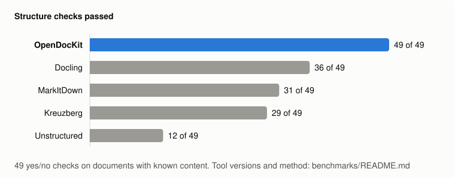

# Benchmark: OpenDocKit and four other document converters

OpenDocKit, [MarkItDown](https://github.com/microsoft/markitdown), [Kreuzberg](https://kreuzberg.dev),
[Unstructured](https://github.com/Unstructured-IO/unstructured) and [Docling](https://github.com/docling-project/docling)
were given the same files on the same machine. This page reports what came out — including the places where
OpenDocKit is not the best choice.

> **Read this first.** The benchmark was written by OpenDocKit's maintainers, so treat it the way you would treat any
> vendor's benchmark: the documents and checks are ours, even though the scoring is done by a program and every
> output is saved. Everything needed to rerun it, on a free GitHub runner, is in this folder. If a check is unfair to a
> tool, or a tool was configured badly, please open an issue — we will fix the benchmark.



## Summary

- **Structure.** On 49 yes/no checks of the kind "is the table still a table", OpenDocKit passes 49; the next
  tool, Docling, passes 36. This is where OpenDocKit is strongest: merged cells, several tables on one sheet,
  Excel's display formats, two-column PDFs, running headers, equations, meeting invitations.
- **Formats.** OpenDocKit reads 26 of the 31 formats tested offline (31 with a vision model for
  images and scans). That is the most of the five. Offline, OpenDocKit does not read PDF (scanned, no text layer), Image (.png), Image (.jpg), Image (multi-page .tiff), Image (.heic) — it has no OCR of its own.
- **Korean documents.** OpenDocKit is the only one of the five that reads HWP and HWPX at all, and it reads
  CP949-encoded text and CSV, which several of the others do not.
- **Speed.** Kreuzberg is in a class of its own (9 s for 743 files). OpenDocKit is #3 of 5 at
  290 s, of which 172 s is LibreOffice converting the 200 legacy `.doc` and `.ppt` files;
  MarkItDown takes 177 s, Unstructured 622 s and Docling 3051 s on a
  CPU-only machine.
- **Hostile input.** On 113 fuzzer findings and attack files from other projects, no tool crashed or hung.
  One file made MarkItDown and Unstructured pass 6 GB of memory; OpenDocKit's largest was about 0.1 GB.

## What was compared

| Tool | Version | Installed as | License |
| :--- | :--- | :--- | :--- |
| [OpenDocKit](https://github.com/hyeonsang010716/OpenDocKit) | 0.2.0 | `opendockit[heic]` | MIT |
| [MarkItDown](https://github.com/microsoft/markitdown) | 0.1.9 | `markitdown[all]` | MIT |
| [Kreuzberg](https://kreuzberg.dev) | 4.10.4 | `kreuzberg[all]` | MIT |
| [Unstructured](https://github.com/Unstructured-IO/unstructured) | 0.27.37 | `unstructured[all-docs]` | Apache-2.0 |
| [Docling](https://github.com/docling-project/docling) | 2.150.0 | `docling` + `docling-slim[format-opendocument,format-office,format-email]` | MIT |

Each tool was installed in its own virtual environment with the extras its documentation lists for full document
support (see [`setup_tools.sh`](setup_tools.sh)), and called through its default entry point with default options
(see [`adapters.py`](adapters.py)). No tool was given an API key or a remote model. System packages that Unstructured
and Kreuzberg need for OCR and legacy formats (Tesseract with English and Korean data, LibreOffice, pandoc, Poppler,
libmagic) were installed for them.

Machine: GitHub-hosted runner, AMD EPYC 9V74 80-Core Processor, 4 cores, 16 GB RAM, no GPU, Linux-7.0.0-1019-azure-x86_64-with-glibc2.43. Run from commit `091ec42`;
OpenDocKit was installed from PyPI.

## 1. Which formats does each tool read?

One representative file per format. ✅ means the output contains every piece of text we looked for; 🟡 some of it;
❌ none, an error, or an empty result. The documents are in [`cases/`](cases/) and the expected strings in
[`probes.py`](probes.py).

| Format | OpenDocKit | … + vision model | MarkItDown | Kreuzberg | Unstructured | Docling |
| :--- | :---: | :---: | :---: | :---: | :---: | :---: |
| **Office** |  |  |  |  |  |  |
| Word (.docx) | ✅ |  | ✅ | ✅ | ✅ | ✅ |
| PowerPoint (.pptx) | ✅ |  | ✅ | ✅ | ✅ | ✅ |
| Excel (.xlsx) | ✅ |  | ✅ | ✅ | ✅ | ✅ |
| Excel 97-2003 (.xls) | ✅ |  | ✅ | ✅ | ✅ | ✅ |
| Excel 2003 XML | ✅ |  | ✅ | ✅ | ✅ | ❌ |
| Word 97-2003 (.doc) | ✅ |  | ❌ | ✅ | ✅ | ✅ |
| PowerPoint 97-2003 (.ppt) | ✅ |  | ❌ | ✅ | ✅ | ✅ |
| Rich Text (.rtf) | ✅ |  | ✅ | ✅ | ✅ | ✅ |
| OpenDocument Text (.odt) | ✅ |  | ❌ | ✅ | ✅ | ✅ |
| OpenDocument Spreadsheet (.ods) | ✅ |  | ❌ | ✅ | ❌ | ✅ |
| OpenDocument Presentation (.odp) | ✅ |  | ❌ | ❌ | ❌ | ✅ |
| **Korean office** |  |  |  |  |  |  |
| Hangul (.hwp) | ✅ |  | ❌ | ❌ | ❌ | ❌ |
| Hangul (.hwpx) | ✅ |  | ❌ | ❌ | ❌ | ❌ |
| CSV in CP949 | ✅ |  | ✅ | ✅ | ❌ | 🟡 |
| Text in CP949 | ✅ |  | ✅ | ❌ | ✅ | ❌ |
| **PDF** |  |  |  |  |  |  |
| PDF (text) | ✅ |  | ✅ | ✅ | ✅ | ✅ |
| PDF (scanned, no text layer) | ❌ | ✅ | ❌ | ❌ | ✅ | ✅ |
| **Web and mail** |  |  |  |  |  |  |
| HTML | ✅ |  | ✅ | ✅ | ✅ | ✅ |
| MHTML (.mht) | ✅ |  | ✅ | ✅ | ✅ | ✅ |
| Email (.eml) | ✅ |  | ✅ | ✅ | ❌ | ✅ |
| Mailbox (.mbox) | ✅ |  | ✅ | ❌ | ❌ | ❌ |
| **Text and data** |  |  |  |  |  |  |
| Plain text | ✅ |  | ✅ | ✅ | ✅ | ✅ |
| Markdown | ✅ |  | ✅ | ✅ | ✅ | ✅ |
| CSV | ✅ |  | ✅ | ✅ | ✅ | ✅ |
| Jupyter notebook | ✅ |  | ✅ | ✅ | ✅ | ❌ |
| EPUB | ✅ |  | ✅ | ✅ | ✅ | ✅ |
| **Images** |  |  |  |  |  |  |
| Image (.png) | ❌ | ✅ | ❌ | ✅ | ✅ | ✅ |
| Image (.jpg) | ❌ | ✅ | ❌ | ✅ | ✅ | ✅ |
| Image (multi-page .tiff) | ❌ | ✅ | ❌ | 🟡 | ✅ | ✅ |
| Image (.heic) | ❌ | ✅ | ❌ | ❌ | ✅ | ❌ |
| **Mislabeled** |  |  |  |  |  |  |
| HTML table saved as .xls | ✅ |  | ✅ | ❌ | ✅ | 🟡 |
| **Formats read** | **26** | **31** | **19** | **22** | **24** | **22** |

Notes:

- The "… + vision model" column is OpenDocKit with `OpenAIImageDescriber` (`gpt-5.6-terra`), run separately
  ([`vision_cases.py`](vision_cases.py)). It needs an API key and costs money; the other four columns to its right do
  their OCR locally and for free. Compare like with like: offline, OpenDocKit does not read images or scans.
- Not tested, and supported by some of the other tools but not by OpenDocKit: audio and video, YouTube and web URLs,
  ZIP archives, Outlook `.msg`, Apple Pages/Numbers/Keynote, LaTeX, XBRL.
- A ✅ here only says the text came through. How well the structure survived is the next section.

## 2. How much of the structure survives?

49 yes/no questions about documents whose content we know exactly, because we generated them
([`make_cases.py`](make_cases.py)). Each question is a few lines of code in [`probes.py`](probes.py); matching ignores
case, whitespace, Markdown escapes and emphasis markers, and accepts both Markdown and HTML tables.

| Checks | OpenDocKit | MarkItDown | Kreuzberg | Unstructured | Docling |
| :--- | :---: | :---: | :---: | :---: | :---: |
| Word (11) | **11** | 9 | 9 | 4 | **11** |
| PowerPoint (5) | **5** | 4 | 3 | 2 | 4 |
| Excel (6) | **6** | 2 | 2 | 1 | 4 |
| PDF (6) | **6** | 2 | 3 | 1 | **6** |
| HTML (10) | **10** | 7 | 9 | 3 | 9 |
| Email (5) | **5** | **5** | 2 | 0 | 2 |
| Korean documents (5) | **5** | 1 | 1 | 0 | 0 |
| Mislabeled file (1) | **1** | **1** | 0 | **1** | 0 |
| **All (49)** | **49** | 31 | 29 | 12 | 36 |

OpenDocKit passes all 49. Read that with the note on author bias at the end of this page in mind.

These are the same 49 checks, unchanged, that were published with the report for OpenDocKit 0.1.0, which passed 43
of them: it had no reader for the OpenDocument, RTF, EPUB and legacy Office files and flattened links and emphasis to
plain text. 0.2.0 was written afterwards with those checks known, so its score says the gaps are closed, not that
OpenDocKit would do as well on checks somebody else wrote.

<details>
<summary>Every check, every tool</summary>

| Check | Document | OpenDocKit | MarkItDown | Kreuzberg | Unstructured | Docling |
| :--- | :---: | :---: | :---: | :---: | :---: | :---: |
| Section titles are Markdown headings | `report.docx` | ✅ | ✅ | ✅ | ✅ | ✅ |
| Bulleted list items are list items | `report.docx` | ✅ | ✅ | ❌ | ❌ | ✅ |
| Numbered steps keep their numbers | `report.docx` | ✅ | ✅ | ❌ | ✅ | ✅ |
| The table is a table (a row holds North, 150, 170) | `report.docx` | ✅ | ✅ | ✅ | ✅ | ✅ |
| The vertically merged 'Domestic' cell still applies to the South row | `report.docx` | ✅ | ❌ | ✅ | ✅ | ✅ |
| The equation is written as LaTeX | `report.docx` | ✅ | ❌ | ✅ | ❌ | ✅ |
| The picture leaves a marker between the text before and after it | `report.docx` | ✅ | ✅ | ✅ | ❌ | ✅ |
| A hyperlink keeps its address | `rich-text.docx` | ✅ | ✅ | ✅ | ❌ | ✅ |
| Bold text stays bold | `rich-text.docx` | ✅ | ✅ | ✅ | ❌ | ✅ |
| Italic text stays italic | `rich-text.docx` | ✅ | ✅ | ✅ | ❌ | ✅ |
| Page header and footer text is kept out of the body | `rich-text.docx` | ✅ | ✅ | ✅ | ❌ | ✅ |
| Each slide title is a heading | `deck.pptx` | ✅ | ✅ | ✅ | ✅ | ✅ |
| A second-level bullet is visibly nested under its parent | `deck.pptx` | ✅ | ❌ | ✅ | ❌ | ✅ |
| Speaker notes are included | `deck.pptx` | ✅ | ✅ | ❌ | ❌ | ❌ |
| The slide table is a table | `deck.pptx` | ✅ | ✅ | ✅ | ✅ | ✅ |
| The native chart becomes its numbers (Week 4: 8100 and 1650 in one row) | `deck.pptx` | ✅ | ✅ | ❌ | ❌ | ✅ |
| Cell values come out as a table | `sales.xlsx` | ✅ | ✅ | ✅ | ✅ | ✅ |
| The second table on the sheet is its own table, with its own header row | `sales.xlsx` | ✅ | ❌ | ❌ | ❌ | ❌ |
| Percentages read as Excel shows them (46.4%) | `sales.xlsx` | ✅ | ❌ | ❌ | ❌ | ✅ |
| Dates read as dates, without a spurious time | `sales.xlsx` | ✅ | ❌ | ❌ | ❌ | ✅ |
| The second sheet is included and named | `sales.xlsx` | ✅ | ✅ | ✅ | ❌ | ❌ |
| A hidden sheet is left out | `sales.xlsx` | ✅ | ❌ | ❌ | ❌ | ✅ |
| Headings are detected from the layout | `service-report.pdf` | ✅ | ❌ | ✅ | ❌ | ✅ |
| The ruled table is a table with all five columns in a row | `service-report.pdf` | ✅ | ✅ | ❌ | ❌ | ✅ |
| The table without borders is still a table | `service-report.pdf` | ✅ | ✅ | ❌ | ❌ | ✅ |
| The header repeated on every page is not repeated in the output | `service-report.pdf` | ✅ | ❌ | ✅ | ❌ | ✅ |
| Page-number lines are removed | `service-report.pdf` | ✅ | ❌ | ✅ | ❌ | ✅ |
| Two-column pages are read down the left column, then the right | `service-report.pdf` | ✅ | ❌ | ❌ | ✅ | ✅ |
| Navigation, script and footer boilerplate is dropped | `article.html` | ✅ | ❌ | ✅ | ✅ | ✅ |
| Hidden elements are dropped | `article.html` | ✅ | ❌ | ✅ | ❌ | ✅ |
| A two-row header with rowspan/colspan still labels the columns | `article.html` | ✅ | ✅ | ✅ | ✅ | ✅ |
| The nested list keeps its nesting | `article.html` | ✅ | ✅ | ✅ | ❌ | ✅ |
| The code block is fenced | `article.html` | ✅ | ✅ | ✅ | ❌ | ✅ |
| MathML is written as LaTeX | `article.html` | ✅ | ❌ | ❌ | ❌ | ❌ |
| A hyperlink keeps its address | `rich-text.html` | ✅ | ✅ | ✅ | ❌ | ✅ |
| Bold text stays bold | `rich-text.html` | ✅ | ✅ | ✅ | ❌ | ✅ |
| Italic text stays italic | `rich-text.html` | ✅ | ✅ | ✅ | ❌ | ✅ |
| An image's alt text is kept | `rich-text.html` | ✅ | ✅ | ✅ | ✅ | ✅ |
| Subject, sender and recipient are kept | `meeting.eml` | ✅ | ✅ | ✅ | ❌ | ✅ |
| The body is read once (not the HTML and the plain-text copy) | `meeting.eml` | ✅ | ✅ | ✅ | ❌ | ✅ |
| The table in the HTML body is a table | `meeting.eml` | ✅ | ✅ | ❌ | ❌ | ❌ |
| The meeting invitation's place and time are readable | `meeting.eml` | ✅ | ✅ | ❌ | ❌ | ❌ |
| Both mails of the mailbox are read, in order | `mailbox.mbox` | ✅ | ✅ | ❌ | ❌ | ❌ |
| The HWP table is a table | `table.hwp` | ✅ | ❌ | ❌ | ❌ | ❌ |
| The HWPX table is a table | `score-table.hwpx` | ✅ | ❌ | ❌ | ❌ | ❌ |
| Multi-level numbering is kept (3.1., 가.) | `numbered-outline.hwpx` | ✅ | ❌ | ❌ | ❌ | ❌ |
| A CP949 CSV is decoded and its rows are a table | `branch-sales-cp949.csv` | ✅ | ✅ | ✅ | ❌ | ❌ |
| Title lines above the header row do not become the header | `branch-sales-cp949.csv` | ✅ | ❌ | ❌ | ❌ | ❌ |
| An HTML table named .xls is read as the table it is | `html-table-named.xls` | ✅ | ✅ | ❌ | ✅ | ❌ |

</details>

Some checks encode an opinion about what is right for LLM input rather than a fact about the document: dropping
navigation and hidden elements, leaving hidden sheets out, removing running headers and page numbers, and showing a
cell the way Excel displays it (`46.4%`) instead of its stored value (`0.464459`). A tool that deliberately does the
opposite fails those checks by design, not by mistake.

## 3. Real files from other projects

743 documents taken from the test suites of Apache POI, pdfplumber, hwplib and hwpxlib
([`corpus.py`](corpus.py) picks up to 100 per format at even intervals). Nobody here wrote or chose these files for a
particular tool. We do not know their correct output, so this section only counts what happened.

| Returned text | OpenDocKit | MarkItDown | Kreuzberg | Unstructured | Docling |
| :--- | :---: | :---: | :---: | :---: | :---: |
| DOCX (100) | 87 | 85 | 86 | 85 | **88** |
| PPTX (84) | **83** | **83** | 81 | 62 | 71 |
| XLSX (100) | 92 | **97** | 88 | 88 | 89 |
| XLS (100) | 91 | **99** | 86 | 84 | 87 |
| PDF (66) | **63** | 62 | 61 | **63** | 55 |
| HWP (44) | **29** | 0 | 0 | 0 | 0 |
| HWPX (49) | **39** | 0 | 0 | 0 | 0 |
| DOC (100) | 93 | 0 | 79 | 89 | **94** |
| PPT (100) | **90** | 0 | 77 | 82 | 83 |
| **All (743)** | **667** | **426** | **558** | **553** | **567** |

| Of the same files | OpenDocKit | MarkItDown | Kreuzberg | Unstructured | Docling |
| :--- | :---: | :---: | :---: | :---: | :---: |
| Error (refused or failed) | 21 | 303 | 76 | 116 | 112 |
| No text returned | 55 | 14 | 109 | 74 | 55 |
| Timed out (120 s) | 0 | 0 | 0 | 0 | 9 |
| Crashed the process | 0 | 0 | 0 | 0 | 0 |

- OpenDocKit reads legacy `.doc` and `.ppt` by handing them to LibreOffice, which this machine has because Unstructured
  and Kreuzberg need it too: 183 of 200 returned text. Without LibreOffice it refuses those two formats.
- "No text returned" is often correct: many test files are blank pages, pictures or shapes. Of the 93 Hangul
  files OpenDocKit returned text for 68; we checked the rest against the preview text stored inside each file, and
  they contain none.
- Kreuzberg accepts `.hwp` files but returned no text for any of them.

| Time to convert, seconds | OpenDocKit | MarkItDown | Kreuzberg | Unstructured | Docling |
| :--- | ---: | ---: | ---: | ---: | ---: |
| DOCX | 4.6 | 47.9 | 1.3 | 35.7 | 40.9 |
| PPTX | 2.7 | 5.2 | 0.4 | 8.9 | 15.9 |
| XLSX | 8.6 | 19.6 | 0.5 | 10.5 | 14.0 |
| XLS | 5.8 | 41.2 | 0.6 | 11.6 | 94.8 |
| PDF | 91.1 | 54.3 | 5.2 | 81.5 | 2,495.1 |
| HWP | 1.9 | 0.9 | 0.2 | 0.1 | 0.2 |
| HWPX | 2.8 | 1.0 | 0.0 | 0.1 | 0.1 |
| DOC | 77.7 | 5.5 | 0.4 | 199.3 | 278.9 |
| PPT | 94.5 | 1.1 | 0.2 | 274.3 | 110.8 |
| **All, seconds** | 290 | 177 | **9** | 622 | 3,051 |
| Median PDF, seconds | 0.21 | 0.16 | 0.02 | 0.25 | 20.66 |

Three workers per tool ran in parallel on the 4-core machine; times are the sum over files of the time inside the
conversion call. Docling and Unstructured run layout and OCR models, which is why they are slow on a machine without a
GPU and why they can read scans that OpenDocKit, offline, cannot.

## 4. Hostile input

The 113 files those same projects keep as fuzzer findings and proof-of-concept attacks (ClusterFuzz test
cases, XML bombs, deeply nested tables). Each file ran in a fresh process with a 60-second limit and a 6 GB memory cap.

| 113 hostile files | OpenDocKit | MarkItDown | Kreuzberg | Unstructured | Docling |
| :--- | :---: | :---: | :---: | :---: | :---: |
| Returned text | 21 | 12 | 15 | 22 | 28 |
| Refused with an error | 88 | 94 | 91 | 85 | 77 |
| No text returned | 4 | 6 | 7 | 5 | 8 |
| Timed out (60 s) | 0 | 0 | 0 | 0 | 0 |
| Crashed the process | 0 | 0 | 0 | 0 | 0 |
| Stopped above 6 GB of memory | 0 | 1 | 0 | 1 | 0 |
| Slowest single file, seconds | 1.6 | 27.6 | 0.2 | 37.6 | 14.1 |
| Peak memory on a single file, MB | 125 | 6,000 | 59 | 6,000 | 1,666 |

The one clear difference is `poc-shared-strings.xlsx`, an Excel file whose shared-string table expands enormously: it
pushed MarkItDown and Unstructured past the 6 GB cap. OpenDocKit bounds decompressed size; its slowest file took 2 s and its largest used
0.1 GB.
This is a small sample; it shows the absence of obvious problems, not robustness in general.

## 5. Footprint

|  | OpenDocKit | MarkItDown | Kreuzberg | Unstructured | Docling |
| :--- | :---: | :---: | :---: | :---: | :---: |
| Installed size | 0.1 GB | 0.3 GB | 5.7 GB | 6.5 GB | 5.9 GB |
| Needs system packages | LibreOffice, only for `.doc` / `.ppt` | no | Tesseract for OCR | libmagic, Poppler, Tesseract, LibreOffice, pandoc | no |
| Runs ML models locally | no | no | optional | yes | yes |

Sizes are of the environments as installed above, with every extra the comparison uses; a tool installed without its
extras is smaller.

## Which one should you use?

- **Korean office documents (HWP, HWPX, CP949), or Office files where tables and layout must survive** → OpenDocKit.
- **Scanned PDFs and images, offline** → Docling or Unstructured. They run OCR and layout models locally; OpenDocKit
  needs a vision-model API for those.
- **Sheer throughput** → Kreuzberg.
- **Audio, video, web URLs, archives, Outlook `.msg`** → MarkItDown or Unstructured; OpenDocKit does not read them.

## Run it yourself

On GitHub: fork the repository, open **Actions → Benchmark → Run workflow**. It takes about 40 minutes on a free
runner and uploads the raw results as an artifact.

Locally, on an x86-64 Linux machine (the ML-based tools crash under Docker on Apple silicon):

```bash
docker build -t opendockit-bench benchmarks
sh benchmarks/fetch_corpus.sh /tmp/corpus
docker run --rm -v "$PWD/benchmarks":/bench -v /tmp/corpus:/corpus:ro opendockit-bench sh run_all.sh
python benchmarks/make_report.py && python benchmarks/charts.py
```

| File | What it does |
| --- | --- |
| [`setup_tools.sh`](setup_tools.sh) | Installs the five tools, pinned, each in its own environment |
| [`adapters.py`](adapters.py) | The one function per tool that the benchmark calls |
| [`make_cases.py`](make_cases.py), [`make_legacy_cases.sh`](make_legacy_cases.sh) | Build the documents in [`cases/`](cases/) |
| [`probes.py`](probes.py) | The expected text per format and the structure checks |
| [`corpus.py`](corpus.py), [`fetch_corpus.sh`](fetch_corpus.sh) | Select and download the public test files, at fixed revisions |
| [`harness.py`](harness.py), [`worker.py`](worker.py) | Run each tool in worker processes with time and memory limits |
| [`report.py`](report.py), [`make_report.py`](make_report.py), [`charts.py`](charts.py) | Score the saved outputs, write this page and the chart |
| [`results/`](results/) | Raw results: per-file outcomes, timings, and each tool's output for every case |

## Limits of this benchmark

- **Author bias.** We chose the documents and wrote the checks, and a maintainer of another tool would have picked
  different ones. The checks include six that OpenDocKit 0.1.0 failed; 0.2.0 was then developed with all of them in
  view, which no other tool here was.
- **Small and synthetic.** The scored documents are 31 files we generated. They are realistic but not real,
  and several tools were not built for the Korean formats that make up part of the set.
- **Defaults only.** Each tool ran with default options. Docling and Unstructured in particular have settings
  (OCR engines, table modes, a GPU) that change both quality and speed.
- **One run, one machine.** Timings come from a single run on a shared 4-core runner; treat differences under 2× as noise.
- **No accuracy score for real files.** For the public corpus we count outcomes, not correctness.
- **A snapshot.** The other four tools are pinned to what was current on 2026-11-12. All five projects move quickly.
